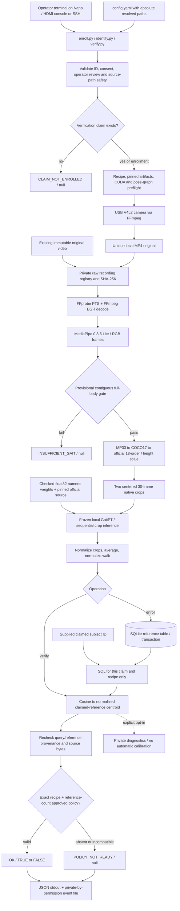

# Jetson Nano Hardware Prototype — Complete Repository Context

Audit date: **21 October 2026 (Asia/Kolkata)**. Repository audited: `/home/arhaan/Arhaan/advanced-gait-analysis-on-embedded-hardware`. This document is intended to stand alone when supplied to an assistant without repository access.

| Snapshot fact | Observed value |
|---|---|
| Current branch | `feat/gait-verification-v2-jetson` |
| HEAD | `c913b40df105a73f996ee5da5a4ac98e7fa347ad` |
| HEAD subject | `Implement gait verification service and enrollment store` |
| HEAD timestamp | `2026-10-20T16:39:25+05:30` |
| Parent | `773207e98bef2090fd09dd9f42e09461fae52315` |
| Initial working tree | Clean; `git status --short` produced no entries |
| Tracked inventory | 91 files, including 65 Python files, before this report |
| Authorized change | This Markdown file only; no implementation, refactoring, dependency installation, database mutation, Git mutation, model download, training, calibration, camera activation, or external upload |
| Audit environment | x86_64 Ubuntu 26.04, Python 3.14.4; **not a Jetson Nano** |

Evidence notation: `path:line` identifies source at the audited revision. Paths are repository-relative unless explicitly described otherwise. **Observed** means inspected or checked during this audit; **reported** means a repository document describes an earlier experiment that was not rerun here; **inference/risk** means a conclusion from source, not a measured result; **planned** means no implementation/evidence was found. Source line numbers may change after later edits.

No other repository was accessed. Research references embedded in copied documents were read as local text only. No external links were visited, and no repository content or invention disclosure was uploaded. Existing binary checkpoints and pose pickle were not deserialized. Participant identities, individual scores, vectors, footage, credentials, and Git-author contact details are deliberately excluded.

## 0a. Update — hardware-lab readiness without a final model (21 October 2026, uncommitted on top of `030ba2c`)

Supersedes conflicting statements below (notably §14 "no integrated display", enroll/verify startup, and "no preflight beyond `check_nano.py`").

* **State.** The final research model does not exist. The Nano now fails closed: `enroll`/`verify` return `MODEL_NOT_DEPLOYED` (or `MODEL_INCOMPATIBLE`), null verdict, unless a package in `model_slot_dir` (`.cache/model-slot`) was explicitly activated. The provisional GaitPT bundle (`bundle_dir`) is `development_only`, reachable only with `--development-baseline`, never approvable. No policy, threshold or calibration was added; `policy: null`.
* **New modules (`src/verification/`).** `model_slot.py` (six independent stages: discovered, structurally_valid, runtime_compatible, parity_tested, approved, active; install/inspect/parity/activate/deactivate; package = `contract.json`, `manifest.json`, `weights.npz`, owner `approval.json`, Nano `parity_report.json`), `readiness.py` (17-check preflight, JSON+Markdown), `camera_diag.py`, `pose_diag.py` (backend registry `POSE_BACKENDS`; capture/store never import it), `dbcheck.py`, `display.py` (status/result screens; TRUE/FALSE only for `OK` + real bool), `lab.py` (entry `scripts/lab.py`: preflight, camera, pose, db, model, display). `cli.py` gained `resolve_model`/`--development-baseline`; `service.py` gained the two statuses; `store.py` closes connections after each operation. `backend.py`, `media.py`, `contract.py`, `deployment.py` (recipe hashes) are unchanged. Config keys added: `model_slot_dir`, `diagnostics_dir`, `reports_dir`.
* **Kit.** `scripts/build_lab_kit.py build|verify` (allowlist + forbidden-content guard + SHA-256 manifest; output `dist/`, git-ignored). Offline Nano wheels are **missing** (`.cache/nano-dependency-wheels` empty; list in the kit's `DEPENDENCIES.md`); torch, MediaPipe 0.8.5 aarch64 and `.cache/GaitPT` are missing too.
* **Docs.** `docs/JETSON_NANO_LAB_RUNBOOK.md`, `docs/FINAL_MODEL_ACTIVATION_RUNBOOK.md`, `docs/JETSON_NANO_PRELAB_READINESS_REPORT.md`; amendments in `ARCHITECTURE.md`, README and both mandatory gait documents. `docs/DEPLOYMENT.md` and `docs/NANO_MIGRATION_VALIDATION.md` are referenced but do not exist.
* **Evidence.** 245 tests pass, 1 skipped (baseline 81+1); ruff clean (line length 110); AST grammar check at Python 3.6 clean plus a 3.7+-API lint (caught and fixed `add_subparsers(required=...)`). Nothing ran on a Jetson or under Python 3.6; no camera was opened; the research repo was only read (`main` `1bce211`, V2 ref `eabfb08`, unchanged).
* **Limits.** Only the pinned official GaitPT-GREW + MediaPipe 0.8.5 recipe can reach `runtime_compatible = PASS`; any other model/pose estimator needs a `GaitBackend`, contract builder and `model_slot.expected_contract` branch. No reprocess-preserved-originals command exists. Next: run the lab runbook on the Nano and record hardware facts; then the research model decision.

## 0. Update — research-to-Nano model synchronization (21 October 2026, uncommitted work on top of `d97d2ce`)

This section supersedes the statements below that conflict with it; the rest of the audit is unchanged and still describes the baseline.

* **Authority.** Research source of truth is branch `origin/feat/gait-verification-v2` (`eabfb08`) of `deepfake-detection`; its checked-out `main` has no gait source. Details, matrix and numbers: `docs/RESEARCH_TO_JETSON_MODEL_INTEGRATION.md`; future-model steps: `docs/RESEARCH_MODEL_DEPLOYMENT_CHECKLIST.md`.
* **Added.** `src/verification/deployment.py` (`nano-deployment-contract-v1`, strict validation, semantic id), `GaitBackend`/`backend_for` in `backend.py`, `src/verification/parity.py` + `scripts/make_parity_fixture.py` + a research-derived fixture under `tests/verification/fixtures/`.
* **Changed.** The recipe (policy/enrollment binding) is now the *semantic* identity (contract + hashes of backend/media/contract/deployment code); torch/CUDA/ffmpeg/python/device and store/service hashes live in `details['runtime']` and are stored per reference. Section 12/13 statements that the recipe mixes runtime versions or that the store allows one recipe per original are obsolete: the store is schema v2 (`PRAGMA user_version=2`, `(take_id, recipe)`/`(source_hash, recipe)` uniqueness, original table kept as `reference_v1`, migrated rows inert). `prototype_score()` was extracted from `Verifier.verify` without changing the math.
* **Evidence.** 81 tests pass (1 model-only parity test skipped without `GAIT_PARITY_GAITPT_SOURCE`; 15 pass in `test_parity.py` on CPU and CUDA when set) on a workstation interpreter borrowed from the research checkout, replacing the earlier "pytest unavailable" status for the engineering suite. Verified against research code: GaitPT checkpoint/source/config hashes, model-input tensors for identical COCO17 joints, model-only embeddings (max abs diff 2.2e-8 CPU / 4.6e-6 CUDA), centroid and cosine arithmetic.
* **Known differences (unresolved, decide with final research model).** RTMPose-COCO17 vs MediaPipe 0.8.5 pose source; research per-2-second-window encoding and mean vs one whole-run encode (cosine 0.99989 on the synthetic fixture); quality thresholds. End-to-end parity is **unverified**; still no Nano run, no policy, no threshold, no final model.
* **Next step.** Select the final research model, export its contract/weights/fixture (checklist), and measure pose-source differences on paired real video.

## 1. Executive summary

This checkout implements a **local, batch, skeleton-based 1:1 claimed-identity gait verification application** intended for an original Jetson Nano. It has real enrollment and verification orchestration, SQLite reference storage, USB recording, video decoding, a MediaPipe pose path, a frozen GaitPT-GREW adapter, cosine comparison, explicit status handling, and a gate for an externally approved decision policy. These mechanisms are implemented in source; their existence is not evidence of successful execution on the target hardware.

The desired daily interaction already exists in the CLI: `scripts/enroll.py --name <ID>` records and enrolls one independent walk; `scripts/identify.py --identity <ID>` records another walk and verifies only that claim. Both require consent for a new recording and operator single-walker review. The `identify.py` filename is historical: **the current script does not identify or rank people**. `verify.py` is equivalent. Both paths use the same recording helper and encoder.

There is **no installed calibrated decision policy**: `config.yaml:8` contains `policy: null`. Consequently, a usable query with compatible references returns **`POLICY_NOT_READY`, `verdict: null`**, even though a cosine is computed. The Boolean path is real conditional code, exercised by synthetic policies in tests according to the prior validation record. No scientifically justified operational TRUE/FALSE result is established by this checkout.

The default runtime cannot be started successfully in the present audit environment. `.cache/gaitpt-grew-npz/weights.npz` and its manifest exist locally, but the configured pinned source directory `.cache/GaitPT` is absent; NumPy, PyTorch, MediaPipe, OpenCV, einops, and pytest are absent from the available interpreter. There is no local `.db` file or V2 recordings registry. A `/dev/video0` node exists on this workstation; it was not opened and is not Nano evidence.

The greatest deployment risk is the unexecuted **Python 3.6/aarch64/JetPack 4.6/CUDA 10.2 native stack**, especially the experimental MediaPipe 0.8.5 community binary and its pose graph/assets alongside NVIDIA PyTorch 1.10. Version metadata and modern workstation inference do not validate that combination. No Nano memory, latency, thermal, power, camera, or HDMI results were found.

The biggest demonstration gap is scientific: a reliable threshold for this exact pose/model/runtime recipe, reference count, and operating conditions is unavailable. Presenting a convenient cosine cutoff as biometric verification would overstate the evidence. A transparent engineering demonstration can show capture, enrollment persistence, claim-only scoring, and explicit non-decisions once the real Nano stack works. A validated Boolean demonstration additionally requires independent recordings, a controlled calibration protocol, frozen artifacts, and licensing clearance.

## 2. Important facts for ChatGPT

1. This hardware repository is separate from the larger research repository. Do not assume any research scripts, datasets, evaluation bundles, RTMPose backends, or GPGait implementations are present here.
2. Source precedence is latest explicit owner instruction, then the technical PRD, then explanatory handoff, then historical material. The **20 October Nano and two-script amendments** override earlier permission for laptop/server inference and earlier identification goals.
3. Only supplied-claim verification is authorized. Fetch that claim's embeddings only. Never add identification, ranking, another-person attribution, or deepfake conclusions from mismatch.
4. Operational video/pose/model inference must execute on the original Nano. Offline numeric-weight preparation on a modern machine is a separate packaging step.
5. Active code is `src/verification/`, not `legacy/src/` and not the historical `models/` pipeline.
6. The frozen encoder is official **GaitPT-GREW** with source/checkpoint hashes. It is first integration, not an empirically selected winner. GPGait-family and E0 remain research comparators.
7. Nano loads float32 **NPZ with `allow_pickle=False`**, not `.pth` or `.pkl`. Never enable an unrestricted loader to accommodate old PyTorch.
8. Old `full_hybrid_best.pth` is a different historical embedded asset from the research shipped E0 and absent controlled LOSO bundle. Its metrics cannot be called a new E0 replay.
9. Missing policy, absent enrollment, unusable gait, invalid input, and processing failure are non-decisions with null verdicts. Only `OK` has a Boolean.
10. Current enrollment data would be individual normalized walk embeddings in SQLite, with a centroid derived for the claim. Legacy `gait_embeddings` instead held raw `60×78` feature arrays.
11. Consent and review flags are trusted operator attestations, not authenticated consent or automatic multi-person/liveness detection.
12. The research plan of approximately **40 people × four independent approximately 30-second views** remains planned/reported as pending. No cohort was found here. Do not claim multi-day validity from one day's four views.
13. The earlier document's **42 passing tests** are a reported prior result. This audit could not run pytest because it is not installed; it independently passed syntax/schema/preservation checks.
14. The current checkout has no integrated enrollment/result GUI, no systemd unit, no Docker setup, no active remote service, no migration/calibration/evaluation command, and no V2 deletion command.
15. Ignored local artifacts exist and are not necessarily portable to a clone. `.gitignore` is neither encryption nor proof that sensitive files were never shared.

Required pre-edit reading for a future authorized implementation: `AGENTS.md`, both complete files in `docs/gait_verification/`, and `docs/ARCHITECTURE.md`. The audit itself changes no product requirement. The owner's audit-only, single-file restriction supersedes the standing instruction to amend both existing contract documents for new owner requirements; relevant conflicts are recorded here without modifying them.

## 3. Project purpose and intended behavior

The owner wants an attached camera and small HDMI LCD around a standalone original Nano. Enrollment supplies a known owner's pseudonymous ID, captures a walk, extracts biometric information, and stores local references. Verification supplies an identity claim, captures a new walk, retrieves only that subject's references, compares gait, and displays TRUE/FALSE when justified by an approved operating policy.

The current product is **pose/skeleton gait verification**. RGB is capture input, not a trained RGB identity network. There is no face recognition or facial verification implementation in the active pipeline. MediaPipe includes head landmarks as skeletal inputs, which does not make this a face matcher. There is no active deepfake classifier or liveness detector.

Historically the hardware project repurposed a pairwise temporal gait network for **1:N open-set identification**. That implementation is preserved under `legacy/`. Even earlier research-oriented text in `OLD_README.md` discusses face-swapped video and unrelated research scripts. Those are provenance, not current capabilities. The latest migration deliberately retires gallery search and arbitrary legacy thresholds.

Intended final behavior is `status=OK, verdict=true/false`. Current default expected behavior for a valid enrolled walk is `POLICY_NOT_READY/null`. The distinction is an explicit product safeguard, not a simulated verification failure. Source: `README.md:3`, `README.md:53`, `src/verification/service.py:33`, `src/verification/policy.py:11`.

## 4. Current implementation status

| Capability | Actual state | Evidence and limit |
|---|---|---|
| Supplied identity CLI | Implemented, required argument | `cli.py:118–125`; ID regex enforced at runtime |
| Fresh USB walk for both operations | Implemented, default 30 seconds | `cli.py:87–97`, `capture.py:8`; hardware execution unverified |
| Original file input | Implemented with explicit registration/consent for new imports | `cli.py:76–84` |
| Pose extraction | Implemented MediaPipe 0.8.5 Solutions Lite wrapper | `backend.py:104`; no real pose run in this audit |
| Learned gait embedding | Implemented frozen GaitPT adapter | `backend.py:61`; official source absent locally |
| Quality abstention | Implemented provisional heuristics | `contract.py:46`; no validated gait/track classifier |
| SQLite persistence | Implemented, transaction before ENROLLED | `store.py:10`, `cli.py:244`; no actual DB present |
| Multiple references | Implemented per independent original | Unique take/hash, normalized equal-weight centroid |
| Claim-only comparison | Implemented | SQL `WHERE subject = ? AND recipe = ?`; no read-all-vector API |
| Conditional Boolean decision | Implemented code, policy absent | `policy.py:42`; synthetic tests are not accuracy evidence |
| Public JSON events | Implemented verification path | No score or candidate output; some outer failures omit event persistence |
| Local logs/private diagnostics | Implemented | Opt-in raw score records; no evaluator here |
| HDMI LCD interaction | Terminal output only for main workflow | Separate OpenCV camera test exists; no kiosk/result GUI |
| Standalone hardware deployment | Not validated | Owner-confirmed intended profile, no actual Nano session |
| Scientific evaluation/calibration | Not implemented in this hardware checkout | Research documents refer to another project |
| Training/threshold fitting | Not part of active runtime and not authorized | Historical model classes include loss methods only |

Documentation disagreements to preserve in future planning:

| Historical statement | Current interpretation |
|---|---|
| `legacy/README.md` says real-time identification, all-gallery matching, CPU fallback | Archived behavior; current system is batch verification, explicit CUDA requirement |
| `OLD_README.md` describes a full research tree, deepfake output, MIT LICENSE, high AUCs | Those research files/metrics/licenses are not established as hardware repository assets; root LICENSE is absent |
| Phase 1 report calls embedding BLOB 128-D and coordinates 18×2 | Legacy actual storage is `60×78`; coordinates are 12×3 (`legacy/database/database_schema.py:37`, pose code) |
| Phase 1 normalization plan says deployment z-scoring was implemented | Superseded; legacy code refuses it; new GaitPT uses its native height scaling |
| Copied PRD describes completed RTMPose/GPGait/evaluation phases | Those amendments describe research work, not files in this checkout; Nano amendment explicitly narrows implementation |
| README says migration may still be uncommitted; validation record says changes local/uncommitted | Stale at audit snapshot: migration is committed at `c913b40`, and cached `origin/feat/gait-verification-v2-jetson` points there |
| Historical performance and source release claims | Local reports only; not independently verified upstream or reproduced here |
| Claims that a live feed cannot be a deepfake | Unsupported as a security guarantee; camera input is not liveness proof |

## 5. Hardware inventory and Jetson environment

### Target versus observed host

| Item | Repository evidence | Verification status |
|---|---|---|
| Board | Original Jetson Nano Developer Kit, intended 4 GB; not Orin | `README.md:77–82`; no serial/board revision or physical inspection |
| CPU/GPU | Legacy documentation describes quad-core Cortex-A57/Maxwell | Historical description only, no device measurement |
| JetPack | Owner-confirmed 4.6.x | Runtime accepts L4T R32.6.x/R32.7.x strings; actual patch release unknown |
| OS | Ubuntu 18.04 intended | Host is Ubuntu 26.04, x86_64 |
| Python | 3.6 intended; legacy examples 3.6.9 | Host Python 3.14.4; `python` executable absent |
| CUDA | 10.2 required, no automatic fallback | Host has no importable torch; no target CUDA execution checked |
| cuDNN | Legacy docs mention 8.2 | Actual target version unverified; runtime recipe records `torch.backends.cudnn.version()` |
| TensorRT | Legacy docs mention 8.2 | No active TensorRT import, engine loader, conversion or benchmark |
| PyTorch | NVIDIA 1.10.0 cp36/aarch64 wheel intended | No wheel install/ABI execution verified by this audit |
| OpenCV | JetPack system 4.1.1 intended | No cv2 in host interpreter; GStreamer backend unverified |
| MediaPipe | Experimental PINTO0309 0.8.5 CUDA 10.2/NumPy 1.19 wheel | Exact wheel installation and pose-graph startup unverified |
| Camera | USB `/dev/video0`, requested 640×480 at 30 FPS | Host device node exists/read-write access reported; never opened; make/model/driver unknown |
| CSI camera | Illustrative GStreamer setup only | No active CSI auto-record path or tested sensor |
| Display | Owner wants small HDMI LCD | No panel model, resolution, EDID, touch driver or tested window setup |
| Storage | SQLite/RGB/model files on local filesystem | No chosen microSD capacity/endurance/free-space measurement |
| Memory | Intended 4 GB shared device memory | No peak RAM/GPU-memory evidence |
| Power | Archived guide mentions 5V/4A barrel supply, J48 and MAXN | Historical recommendation, not physical inventory or current tested prerequisite |
| Thermal/cooling | No current measurement | Fan/heatsink, throttling and sustained performance unknown |

`environment.py:43–105` checks architecture, Ubuntu release, Python prefix, hardware model string, L4T pattern, package versions/imports, torch CUDA 10.2 and availability, FFmpeg/ffprobe/libx264, and optionally camera-node access. It does not directly certify JetPack installation, cuDNN/TensorRT, GPU compute correctness, available RAM, disk capacity, thermals, or camera negotiation. `camera_accessible=true` is only filesystem access, not successful capture.

On aarch64, `runtime_recipe()` calls the profile validator without a camera check. The live paths preflight model loading and the actual MediaPipe graph before recording. On x86, profile validation is not automatically enforced by that function; explicit `cpu` is an engineering option. `check --require-nano` separately requires the original Nano hardware string. These are guards, not protection against a malicious local operator.

Main enrollment/verification has no `imshow` dependency and is designed for terminal/SSH operation. The chosen community MediaPipe build may still require a working GL/EGL/display environment; the repository explicitly leaves actual headless graph startup unvalidated. Keyboard/terminal input is needed to launch commands; no touchscreen/button flow is implemented.

## 6. Repository tree

The following covers the complete tracked functional layout, with empty/docstring package initializers grouped. Runtime/ignored items are separately marked. This is the audited branch, not a proposed research tree.

```text
.
├── .gitignore
├── AGENTS.md, CLAUDE.md
├── README.md, OLD_README.md
├── config.yaml
├── requirements.txt, requirements-jetson.txt, pytest.ini
├── init_db.py
├── scripts/
│   ├── gait.py
│   ├── enroll.py
│   ├── identify.py
│   ├── verify.py
│   ├── check_nano.py
│   ├── prepare_gaitpt.py
│   └── test_camera.py
├── src/
│   ├── __init__.py
│   ├── camera/{__init__.py,camera_manager.py}
│   ├── utils/{__init__.py,config.py,logger.py,preview.py}
│   └── verification/
│       ├── __init__.py
│       ├── artifacts.py
│       ├── backend.py
│       ├── capture.py
│       ├── cli.py
│       ├── contract.py
│       ├── environment.py
│       ├── media.py
│       ├── policy.py
│       ├── registry.py
│       ├── service.py
│       └── store.py
├── tests/verification/
│   ├── test_camera_workflow.py
│   ├── test_cli_media.py
│   ├── test_contract.py
│   ├── test_nano_environment.py
│   └── test_runtime.py
├── models/
│   ├── __init__.py
│   ├── full_pipeline.py
│   ├── gait_encoder.py
│   ├── temporal_model.py
│   ├── identity_verifier.py
│   └── checkpoint/full_hybrid_best.pth
├── docs/
│   ├── ARCHITECTURE.md, SETUP.md, DEPLOYMENT.md
│   ├── NANO_MIGRATION_VALIDATION.md
│   ├── NANO_PACKAGE_AUDIT.json
│   ├── decisions/001-local-nano-verification.md
│   ├── gait_verification/
│   │   ├── GAIT_VERIFICATION_REARCHITECTURE_HANDOFF.md
│   │   └── GAIT_VERIFICATION_TECHNICAL_PRD.md
│   └── phase-reports/{PHASE_1_COMPLETE.md,PHASE_1_UPDATE.md}
├── legacy/
│   ├── README.md, README_ARCHIVE.md, config.yaml, init_db.py
│   ├── database/{__init__.py,database_schema.py}
│   ├── diagnostics/{check_metrics.py,investigate_checkpoint.py,test_model_loading.py}
│   ├── docs/{ARCHITECTURE.md,SETUP.md,DEPLOYMENT.md}
│   ├── scripts/{enroll.py,identify.py,test_camera.py}
│   └── src/
│       ├── database/{__init__.py,gait_database.py}
│       ├── enrollment/{__init__.py,enrollment_manager.py}
│       ├── events/{__init__.py,identity_event.py}
│       ├── features/{__init__.py,gait_features.py}
│       ├── identification/{__init__.py,identifier.py}
│       ├── model/{__init__.py,gait_model.py}
│       ├── pose/{__init__.py,pose_extraction.py,pose_extraction_gpu.py}
│       ├── rpa/__init__.py
│       └── utils/{config.py,logger.py,preview.py}
└── JETSON_NANO_HARDWARE_PROTOTYPE_COMPLETE_CONTEXT.md  [this audit deliverable]
```

Observed local additions outside the tracked functional tree:

| Location | Observed contents and meaning |
|---|---|
| `database/` | Empty directory; no `gait.db` |
| `data/` | Absent; no V2 DB, registry or captured walks |
| `.cache/gaitpt-grew-npz/` | Ignored numeric weights and manifest; present |
| `.cache/GaitPT/` | **Absent** despite default config reference |
| `.cache/compat-einops-0.4.1/` | Earlier compatibility copy of upstream package; not automatically on import path |
| `.cache/compat-pip-21.3.1/` | Earlier bootstrap tooling; not the active application |
| `.cache/nano-dependency-wheels/` | Local cache directory; not a verified complete installation |
| `.cache/nano-package-metadata-audit.json`, `nano-wheel-dependencies.json`, `nano-wheel-requirements.txt` | Earlier package-audit working artifacts |
| `models/checkpoint/gaitgraph2_oumvlp.pth` | Ignored extra checkpoint, not an active backend |
| `outputs/research_poses.pkl` | Potential biometric pose cache; content not deserialized |
| `outputs/events/` | 52 historical identity-event JSON files; privacy-sensitive |
| `outputs/logs/gait_identification.log` | Historical log, not a V2 hardware validation record |
| `.pytest_cache/`, `.ruff_cache/`, bytecode caches | Existing tooling byproducts, not test evidence on their own |

No tracked notebooks, shell installers, Dockerfiles/Compose configuration, systemd services, CI workflow, packaging `pyproject.toml`/`setup.py`, root LICENSE, frontend application, or physical LCD driver was found. Mention of such paths in OLD_README/research documents does not create them here.

### Relevant local Git history

`a694177` introduced the old live gait identification pipeline. `86899d5` vendored the small historical checkpoint. `b1882f7`, `1550294`, and `773207e` improved Nano instructions/preview/SSH support. Current `c913b40` is a single large migration over `773207e`: 78 changed files, 5,723 insertions and 935 deletions according to Git; it archives old behavior and introduces V2.

Other cached refs contain work **not merged into HEAD**: `origin/dual-camera-support` at `27d5896` has dual-camera modules/scripts; `origin/pretrained-skeleton-gait` at `1af3bce` has another line of changes; `origin/master` at `ac7243c` has fullscreen/replay enrollment and `docs/DEMO.md`. Those files are absent from this checkout. Do not claim dual-camera or fullscreen/replay support, or merge those branches, from this audit. Local `master` points to `773207e`. No fetch was performed; remote-tracking refs describe cached local knowledge only.

## 7. Software architecture diagram



All operational boxes are local processes/files. The database supplies only the claim's vectors; registry metadata may be scanned across records for integrity, which is different from scoring other identities. Model/package acquisition and safe numeric export are provisioning, not remote inference services.

Initialization reads schema-2 YAML, resolves paths against the config's directory, reads/checks registry metadata and source aliases, creates an operator log, validates operation inputs, opens/initializes SQLite as needed, checks enrollment existence, derives a recipe, lazily constructs the encoder, and preflights it before live capture. The same encoder instance is reused for that command's inference. A later process reconstructs it; there is no daemon/model cache across processes.

Shutdown is ordinary process completion. MediaPipe uses context managers; the decoder generator is explicitly closed and its subprocess killed/waited if unfinished. Capture uses a bounded `subprocess.run`. SQLite transactions commit/rollback through connection context managers, but those contexts do not explicitly close the connection; see risk register. No coordinated shutdown service, signal handler, startup application, or reboot recovery is implemented.

## 8. Important source files and responsibilities

### Active core

| File / lines | Main classes/functions | Inputs → outputs; responsibility |
|---|---|---|
| `src/verification/cli.py:19` | `configuration` | Config path → schema-2 dict with paths resolved relative to config file; no full typed schema |
| `cli.py:33`, `:51`, `:57` | `operator_logger`, `emit_verification`, `protect_originals` | Private append log; verification JSON/event + exit status; refuse mutable DB/log/registry aliases to registered/explicit input originals |
| `cli.py:68–97` | `consent_reference`, `existing_recording`, `camera_recording` | Attestation/import or USB video → registered raw row; query owner remains null |
| `cli.py:100` | `main` | Six subcommands; enrollment, verification, setup/error/status orchestration |
| `contract.py:17–43` | `identifier`, `sha256_file`, `fingerprint`, `normalize` | Strict ID; blockwise file hash; canonical JSON hash; finite nonzero vector → normalized float32 |
| `contract.py:46` | `native_crops`, `InsufficientGait` | Full-rate MP33 pixel xy, visibility, PTS, dimensions → `(2,30,18,2)` or explicit quality exception |
| `capture.py:8` | `capture_video` | New path + camera settings + seconds → local V4L2 encoded file; refuses overwrite |
| `media.py:10`, `:41` | `inspect_video`, `video_frames` | File → rotated dimensions and per-frame PTS; iterator of PTS/BGR frames; stream/frame/size validation |
| `backend.py:18`, `:30`, `:37` | `pose_assets`, `pose_runtime_smoke`, `runtime_recipe` | Exact pose version/assets/graph and source/bundle/runtime → recipe hash + details |
| `backend.py:61` | `LocalGaitPT` | Pinned source/NPZ/device → frozen encoder; `encode_batch` and `encode(video)` return normalized measured-dimension vector |
| `artifacts.py:19`, `:46` | `validate_tensor_header`, `load_arrays` | Bounded numeric NPZ → finite float32 tensors, no pickle/object load |
| `artifacts.py:69`, `:93` | `prepare_bundle`, `check_bundle` | Modern restricted checkpoint export; source/config/numeric-weight manifest verification |
| `registry.py:11`, `:31` | `private_json`, `validate_datetime` | Exclusive private temporary write/replace; seconds-precision timezone-aware datetime parser compatible with 3.6 |
| `registry.py:37` | `RecordingRegistry` | Raw record metadata ↔ private JSON; role/owner/take/hash validation, registration, source resolution and reference validation |
| `store.py:10` | `EnrollmentStore` | File-backed SQLite; `add`, `claim(subject,recipe)`, `has_claim`; no gallery-vector enumeration/deletion API |
| `service.py:16`, `:26` | `response`, `Verifier.verify` | Query + supplied claim → public status/Boolean-or-null; score only that claim and optionally emit private diagnostic |
| `policy.py:11` | `decide` | Raw cosine + recipe + reference count + trusted policy/evidence files → `OK/Boolean` or `POLICY_NOT_READY/null` |
| `environment.py:16–105` | Package pin reader, collector, validator, `require_nano_environment` | Installed stack metadata/imports → explicit conflicts; no installation |
| `environment.py:108` | `camera_decode_smoke` | Temporary two-second USB clip → actual decode-count/dimensions report, clip removed on context exit |

Dependencies form a small layered package: CLI uses registry/store/service; service uses contract/policy; backend uses media/artifacts/contract; environment imports capture/media lazily for camera testing. Heavy torch/MediaPipe imports are mostly deferred until backend setup, but the CLI's contract/store imports still require NumPy. Thus `gait.py --help` is not entirely dependency-free on a bare interpreter.

### Entry points and retained utilities

`scripts/gait.py`, `enroll.py`, `identify.py`, and `verify.py` prepend the repository root to `sys.path`, set `umask(077)`, call shared `main`, and propagate exit codes. `init_db.py` resolves default config and initializes only V2. `prepare_gaitpt.py` is the modern export tool. `check_nano.py` is a stdlib-based environment CLI until optional capture dependencies are needed. `test_camera.py` is the independent OpenCV preview/snapshot test.

`src/camera/camera_manager.py:15` opens numeric devices with OpenCV default backend or a string with `CAP_GSTREAMER`; it requests width/height/FPS, logs actual properties, yields frames until a failed read, and releases the device. **The main enrollment/verification recorder does not use this class.** `src/utils/config.py` is the preview's cached YAML reader; `src/utils/logger.py` provides its optional rotating logger. V2 uses its own path resolution and non-rotating operator logger.

`src/__init__.py` still labels the package “Gait-Based Edge Identification System” and sets `__version__ = "1.0.0"`; that inherited label is not the current product task or the CLI/config schema version. Other active package initializers are descriptive only; `legacy/database/__init__.py` re-exports its archived schema helpers. No notebook or hidden initializer supplies an additional inference path.

`src/utils/preview.py:8` still imports `src.pose.pose_extraction`, which no longer exists at that active path. Importing this retained historical overlay helper would fail even in a complete dependency environment. It is unused by the current main workflow and should not be assumed to provide an integrated display.

### Archived and historical modules

| File | Main implementation / status |
|---|---|
| `legacy/src/enrollment/enrollment_manager.py:32` | `EnrollmentOutcome`, `enroll_from_camera`; live buffer, quality filtering, 3–5 accepted sequences, average raw signature, DB write, optional skeleton/progress preview |
| `legacy/src/features/gait_features.py:19–101` | `CapturedSequence`, `LiveSequenceBuffer`, `average_sequences`; detected-frame accumulation, flush at `max(min_valid_frames,sequence_length//2)`, 60×78 resampling, quality fraction |
| `legacy/src/pose/pose_extraction.py:34` | `GaitFeatureExtractor`; Tasks or old Solutions pose; 33 xyz → 12 joints/6 angles/differences; offline extraction/pickle helpers |
| `legacy/src/pose/pose_extraction_gpu.py:46` | `MoveNetExtractor`; optional lazy TensorFlow GPU/CPU alternative, 17 joints, 192/256 square input, sampled/padded 60 frames; unused by archived enrollment/matcher |
| `legacy/src/model/gait_model.py:48` | `GaitModel`, `IdentificationResult`, unrestricted `load_checkpoint`; all-gallery pairwise scores and top-k, legacy 0.7737 fallback; archival only |
| `legacy/src/database/gait_database.py:33` | `GaitDatabase`; enroll/update name, append BLOB signature history, latest gallery, delete identity, log candidate events |
| `legacy/database/database_schema.py:17` | Four user-table legacy SQL schema and indexes/metadata, plus SQLite's autoincrement table |
| `legacy/src/identification/identifier.py:27` | `GaitIdentifier`; camera loop → complete gallery → model → database event → JSON/optional webhook; optional preview |
| `legacy/src/events/identity_event.py:21` | `IdentityEvent`, `build_event`, `emit_event`, `_post_webhook`; score/name-bearing event, optional HTTP POST; not used by V2 |
| `legacy/src/rpa/__init__.py` | Placeholder for a future automation platform; no platform integration |
| `legacy/src/utils/*` and `legacy/scripts/*` | Preserved old config/log/preview and enrollment/identification/camera commands; obsolete import/root assumptions |
| `legacy/diagnostics/*` | Standalone checkpoint introspection and six-check dummy model runner; some read a sibling repository path and use pickle; never executed in this audit |
| `models/full_pipeline.py:25` | `GaitDeepfakeDetector`, triplet subclass and factory; historical model, not active GaitPT |
| `models/gait_encoder.py:19` | Residual Conv1D and multiscale auxiliary encoders |
| `models/temporal_model.py:22` | Positional encoding, BiLSTM, Transformer, fusion, attention pooling |
| `models/identity_verifier.py:21` | Learned pair comparator, triplet/contrastive losses, `IdentityVerifier`; historical auxiliary branches |

The archive is byte-preserved rather than repackaged as a runnable independent distribution. It imports old root names such as `src.pose`, `src.model`, and `database.database_schema`; utilities may derive `legacy/` as their root. Do not run those scripts in place as an operational fallback. No archived training method or `__main__` random-tensor check was executed.

## 9. Camera and video pipeline

### Shared operational USB capture

Call flow: wrapper script → `cli.main` → ID/consent/claim checks → `runtime_recipe` → `LocalGaitPT` construction + `pose_runtime_smoke` → `camera_recording` → `capture_video` → `RecordingRegistry.register_operational` → `LocalGaitPT.encode`.

Defaults are `camera.device_id: 0`, `fps_target: 30`, `resolution: [640,480]`, and 30 seconds. A numeric device becomes `/dev/videoN`; explicit paths must start `/dev/video`. Capture duration must be 1–120 seconds; requested width 1–1920, height 1–1080, FPS 1–60. Those ranges do not establish that a driver/codec supports every value; odd yuv420p dimensions may fail.

Actual child command assembled by `capture.py:26`:

```text
ffmpeg -nostdin -v error -n -f v4l2
  -framerate <fps> -video_size <width>x<height> -i /dev/videoN
  -t <seconds> -an -vsync 0 -c:v libx264 -preset ultrafast
  -crf 18 -pix_fmt yuv420p <new-local-path>
```

`-n` prevents overwrites. UUID-named operational MP4s go to `data/raw/camera/`. Direct capture can use another supplied new output path. Parent directories are requested mode 0700; successful files are chmod 0600; wrapper umask is 077. The subprocess must succeed within `seconds+30`, and the resulting file must be nonempty. Recording instructions go to stderr; results go to stdout.

Capture writes encoded original camera output, without audio. The project does not first save sensor/Bayer or lossless raw frames. Here **raw/original** means the preserved first registered camera file, not RAW sensor format. No capture-time resize, rotation, stabilization, keypoint processing, frame queue, exposure control, autofocus control, camera calibration or input pixel format selection is implemented. FFmpeg negotiates the camera format; actual negotiated FPS/input format are not persisted as structured capture metadata. `-vsync 0` avoids a requested resampling step but is not evidence of zero camera/driver drops or exact exposure timestamps.

Enrollment and verification use the same helper and current config, eliminating separate main capture implementations. Changes to camera settings are not directly included as a camera-config field in `runtime_recipe`; changed image geometry/conditions can still alter the score distribution. Operator acquisition consistency remains necessary.

### Registry and inference-ready media

After capture, the source is SHA-256 hashed and registered. Enrollment has the known owner ID; an operational query has `subject_id: null`. `captured_at` is recorded immediately before starting capture; `registered_at` is separate. This is wall-clock metadata, not a per-frame sensor clock.

`inspect_video()` runs ffprobe with 60-second timeout, selects all video streams, requests width/height/display rotation and every frame's `best_effort_timestamp_time`. Exactly one video stream is required. It uses original presentation timestamps, requires strict increases/finite values, and allows 31–7,200 frames with first-to-last PTS span ≤120 seconds and displayed dimensions ≤1920×1080 in either orientation. Under 31 frames raises `InsufficientGait`; other metadata violations raise errors. Rotation must be a multiple of 90 degrees; width/height swap for portrait.

`video_frames()` uses FFmpeg default display autorotation and `-map 0:v:0 -vsync 0 -f rawvideo -pix_fmt bgr24 pipe:1`. It reads exactly `width×height×3` bytes for each known PTS, detects truncation/extra frames/nonzero decoder exit, and yields `(timestamp,BGR ndarray)`. It does not silently interpolate/resample or save modified RGB. BGR is converted to contiguous RGB for MediaPipe.

Missing detections remain as NaN xy and zero visibility at their original frame positions. Only the longest acceptable contiguous region is selected later. No compacted timeline is fabricated. The active backend does not persist pose arrays, detailed quality traces or per-frame timestamps after inference; future traceability would require an explicitly authorized cache/diagnostic design.

### Capture limitations and recovery

No camera warm-up/countdown, end-user preview, buffer/drop telemetry, duplicate-frame detector, camera disconnect retry or low-light/blur measurement is implemented. Full-body visibility is checked from pose only after recording. MediaPipe cannot establish that there was only one person; review is operator-enforced. No fixed camera distance/view is enforced; archived 2–3 m/across-frame suggestions are not a validated Nano SOP.

A failed FFmpeg command can leave a partial file. A successful capture is registered before pose quality or DB insertion, so bad gait can leave a preserved original and registry row with no enrollment. This is honest retention, but there is no automatic retry/recovery/garbage-collection workflow or atomic transaction across video, JSON registry and SQLite.

The decoder's blocking pipe reads have no whole-operation deadline; `process.wait(timeout=30)` happens after frame consumption. A hung decoder/read can therefore exceed the nominal bounded-video expectation. ffprobe also assembles all requested frame metadata before count rejection, so the media bounds are not complete denial-of-service resource bounds.

### Preview and CSI are distinct paths

`scripts/test_camera.py` uses OpenCV `CameraManager`, not FFmpeg recording. GUI mode displays a window until q; `--no-display` reads up to 100 frames and writes a UUID JPEG snapshot under the current working directory's `outputs/`. It checks nonzero frames in headless mode. There is no read timeout, and GUI mode can return success after an early stream end. The snapshot path is private and exclusive; existing user snapshots are preserved.

Numeric OpenCV devices use its default backend; strings are treated as GStreamer pipelines. A plain string `/dev/video0` in preview config is therefore not equivalent to the main recorder's path handling. The `gait capture` command defaults explicitly to `/dev/video0`, while normal enroll/verify honor configured device if no CLI override. `docs/SETUP.md:22` gives an illustrative local CSI GStreamer command, not a tested automatic enrollment mode. No driver or sensor was probed during this audit.

## 10. Pose estimation and gait-model pipeline

### Active pose algorithm

MediaPipe **0.8.5 Solutions Pose**, `model_complexity=0`, `static_image_mode=False`, `smooth_landmarks=False`, minimum detection/tracking confidence 0.5. All 33 xy landmarks are retained in displayed-image pixels, with MediaPipe visibility. No z is used by GaitPT. Required local assets under the installed package are `modules/pose_detection/pose_detection.tflite` and `modules/pose_landmark/pose_landmark_lite.tflite` (`backend.py:18–35`). Asset absence/version mismatch fails; the wrapper refuses relying on automatic downloads.

The `.tflite` architecture/weights are external package assets, absent from this checkout and not independently inspected here. Wheel provenance, pose inference device/GL behavior, model training datasets and graph compatibility are not established by the source wrapper. Do not claim GPU-accelerated pose simply because the wheel filename contains CUDA. GaitPT's device is separately explicit.

### Provisional admission gate, exactly as implemented

`contract.py:46–98` requires shape `(N,33,2)` xy, `(N,33)` confidence, `(N,)` PTS, N≥31, positive dimensions and finite strictly increasing PTS. Mapped COCO joints plus heel/toe landmarks 29–32 must all be finite, visibility≥0.5, and strictly inside the displayed frame. Border coordinates at 0 or exactly width/height are rejected.

For adjacent fully observed frames, mean mapped-joint displacement above **0.2 image height** anywhere rejects the input as uncertain track/camera discontinuity. Consecutive observed runs are split at missing/low-confidence frames or PTS gaps above **0.1 seconds**. The longest by frame count is selected; it must contain ≥31 frames spanning ≥0.8 seconds. The code does not try a shorter alternative run if this chosen run later fails motion/scale checks.

Median mean-foot-y minus hip-y must be ≥0.15 image height. Maximum standard deviation of foot xy relative to hips must be ≥0.003 image height. This is a motion/leg-resolution heuristic, not gait-cycle detection, cadence estimation, stable-person tracking, 3D body measurement or liveness verification. Head and upper-limb visibility requirements may cause side/occluded walking to abstain; no view-specific coverage evidence exists.

### Exact native conversion and sampling

MediaPipe → COCO17 indices:

```text
(0,2,5,7,8,11,12,13,14,15,16,23,24,25,26,27,28)
 nose, left/right eye, left/right ear, shoulders, elbows, wrists,
 hips, knees, ankles in COCO order
```

The implementation uses MediaPipe eye indices 2/5 as its explicit mapping. Source-native 18-point order applied to COCO17:

```text
(0,1,3,0,2,4,5,7,9,6,8,10,11,13,15,12,14,16)
```

The repeated nose is intentional according to the pinned GREW contract, **not an inferred neck**. Both x and y are divided by image height. No hip centering, body-scale normalization, z-coordinate, handcrafted angles or legacy 78-channel input is applied to GaitPT.

For a qualifying segment of length N, halves are `coco[:max(N//2,30)]` and `coco[min(N//2,N-1-30):N-1]`; each yields the centered 30-frame crop using `start=int(len(half)/2-15)`. Final-frame exclusion is retained. Result is float32 `(2,30,18,2)`, processed as two sequential `(1,30,18,2)` forwards. For N=31 the crops coincide; they are not independent observations. A 30-second walk is not exhaustively sliding-window encoded: only two selected 30-frame crops from its longest accepted run contribute.

**Important scientific risk:** motion is checked across the entire selected run, not separately in each final crop. A long segment with movement elsewhere could pass while the centered crops contain standing. Likewise time gaps reset runs, but there is no person-ID continuity evidence across missing intervals. These are source-derived limitations, not reproduced biometric failures. Any future correction changes the recipe and requires recalibration/re-enrollment planning.

### GaitPT loading and embeddings

`LocalGaitPT` imports the hash-checked external `gaitpt.py` with `importlib`, reads hash-checked `configs/gaitpt_config.yaml`, overrides sequence length to 30, instantiates `module.GaitPT(SimpleNamespace(**config))`, loads numeric state keys/shapes strictly, moves to configured CUDA/explicit engineering CPU, sets eval and `requires_grad_(False)`, and uses `torch.no_grad()`. No optimizer, backpropagation or training loop exists on this active path.

GaitPT is described locally as a hierarchical skeletal Transformer pretrained on **GREW**. Exact upstream block depths/hyperparameters cannot be independently reconstructed from an absent source/config; they are deliberately not invented here. Earlier workstation evidence reports **4,484,384 parameters** and **256 output dimensions**. This audit independently found 4,484,384 float32 elements across 287 numeric-array headers, consistent with that report, but did not execute the model or prove which state entries are trainable parameters.

Each crop output is finite/nonzero normalized; crop vectors are averaged then normalized to a walk vector. `embedding_dim` begins unset and is measured on the first output; subsequent outputs must agree. There is no persisted dimension column in SQLite; incompatible reference dimensions fail later via stacking/dot errors. The final query is compared by dot product to the normalized mean of that claimed subject's normalized walk embeddings: a cosine, not a probability.

### Recipe binding

`runtime_recipe()` hashes a dictionary containing model manifest, pose backend/version/settings and both asset hashes, quality recipe string, native sampling/normalization label, crop/walk/centroid aggregation label, raw variant, torch/NumPy/einops/CUDA/cuDNN/device, machine/Python/FFmpeg version, operator one-walker assumption, and hashes of `backend.py`, `media.py`, `contract.py`, `store.py`, `service.py`. Exact version or implementation changes can invalidate existing references/policy.

The details dictionary is emitted by `recipe`/`check`, but SQLite stores only the recipe digest. Retain the actual details report externally for reproducibility. The recipe does not hash every module: `registry.py`, `policy.py`, capture code/config, full dependency graph and FFprobe version are not all independently bound. Model manifest integrity is locally operator-controlled, not cryptographic provenance authentication.

### Historical algorithms, excluded from the active result

The preserved legacy extractor builds **60×78** features: 36 hip-relative xyz coordinates for 12 joints; six angles in order left knee, right knee, left hip, right hip, left ankle, right ankle; 36 adjacent coordinate differences, padded with the final difference. Landmark sequences are linearly resampled by detected-pose index first, not physical PTS. Accelerations, step-width and symmetry are also computed but do not enter those 78 channels. These differences are not timestamp-derived physical velocity.

The historical `GaitDeepfakeDetector.forward(mode='verification')` (`models/full_pipeline.py:193–270`) computes raw `[V-C, abs(V-C), V*C]`, shape `(B,60,234)`, then Conv1D 234→64 (kernel7), 64→64 (kernel5), 64→32 (kernel3), batchnorm/ReLU/dropout, adaptive temporal average, and MLP 32→32→2 using the archived small config. It returns softmax class-1 score. The decisive head has a reported 133,058 parameters. The 128-D CNN/BiLSTM/Transformer branch is computed but does not feed these verification logits; it adds overhead and is not a validated identity embedding merely because it exists.

The wrapper registers auxiliary residual CNN, bidirectional LSTM, Transformer mean pooling/fusion, learned embedding comparator, standalone classifier and optional triplet/contrastive losses. Default factory dimensions are larger than the small checkpoint's archived config. No training dataset was loaded to verify checkpoint provenance; local docs attribute historical training to 13 people. Archived code loads unrestricted pickle and has CPU-auto fallback; neither is authorized for new runtime.

MoveNet's alternative TensorFlow path downloads a model if instantiated, selects 17 COCO joints, samples/pads to 60 frames, uses eight gait joints and four radian knee/hip angles. It cannot silently substitute for heel/toe/xyz 78-D legacy or GaitPT preprocessing. The ignored GaitGraph2 checkpoint has no corresponding active integration. RTMPose, GPGait/GPGait++, adapters, stabilization and research evaluators are not implemented here.

## 11. Enrollment pipeline

### Current enrollment, step by step

1. `scripts/enroll.py` invokes shared CLI as subcommand `enroll`, with `umask(077)`. `--name` and `--subject-id` are aliases for a required case-sensitive ID. Allowed syntax is `[A-Za-z0-9_-]{1,64}`; spaces, path separators, Unicode names and empty values are refused. It is an ID field despite the alias `--name`.
2. `--single-walker-reviewed` must be present. A new camera recording also requires `--consent` or `--consent-ref`. `--consent` generates `operator-attestation:<current UTC timestamp>`, not a signed consent form. Already registered video imports rely on existing registry consent.
3. Config and registry are loaded; mutable original aliases are refused. The operator log and separate V2 SQLite schema are initialized. The video path must exist if supplied. Argument-parser failures occur before JSON error handling.
4. With `--video`, resolve its actual byte hash to an existing registered original, or require `--register-original` plus consent to create an operational enrollment row. Existing registered owner must equal supplied ID. Capture time may remain unknown for operational import; managed-study originals require actual session/view/time.
5. Derive exact current runtime recipe. For live capture, load strict frozen model and run MediaPipe blank-frame graph smoke before asking for a walk. Capture a new UUID MP4, register it as operational enrollment with supplied owner, and retain source path/hash/take.
6. `LocalGaitPT.encode` decodes every frame, extracts pose, applies quality/native conversion, obtains normalized walk embedding. Enrollment does not average several takes in advance or create overlapping-window references.
7. Re-resolve source after encoding and require equality with original row. `store.add()` validates ID/take/role, normalizes vector, inserts one row inside a SQLite transaction and commits.
8. Only after insert returns does CLI print `ENROLLED`, subject ID, original take ID, recipe hash, absolute DB path and compatible reference count; exit 0. It then performs another claim query to count references.

Example supported syntax, using a synthetic pseudonym rather than a participant name:

```bash
python scripts/enroll.py --name S001 --consent --single-walker-reviewed
python scripts/enroll.py --subject-id S001 --seconds 30 --device /dev/video0 \
  --consent-ref consent-S001 --single-walker-reviewed
```

These are future operational commands and activate a camera. They were **not executed in the audit**. Each invocation captures a different take; repeated ID adds references rather than overwriting the identity. No model retraining or class-head resizing is required for another ID.

### Persistence, duplicates and failures

Duplicate take IDs or byte hashes anywhere in the store are rejected by UNIQUE constraints, even for another subject or recipe. There is no upsert, replace, amend, rename, enrollment-delete, or reference-revoke API. An existing ID can have several independent take rows. Same original cannot be reused for a second recipe in one DB: documentation requires a new store and re-enrollment after recipe changes. Exact recipe matching prevents blindly reading an older embedding.

Insufficient pose/gait yields `INSUFFICIENT_GAIT/null` and no embedding insert. Other failures in the outer CLI generally yield `PROCESSING_ERROR/null`, exit 2. A captured or newly imported source may already be registered by then and is retained. Duplicate-original insertion is also reported through generic processing failure, not a specialized duplicate status. For imported files, duplicate checks can occur only after expensive extraction. There is no multi-resource transaction or restart journal spanning capture/registry/DB.

SQLite insertion commits before success is reported, but a later count/output failure could report failure after a committed insert. Retry is not idempotent. No scientifically justified minimum reference count or per-view enrollment requirement is enforced; an approved policy must bind the count used at verification.

The desired enrollment mechanism is therefore **implemented at software level, unvalidated on Nano/real gait in this audit**, rather than missing or simulated. Camera/model boundaries in workflow tests are fixtures. No actual enrolled participant database was found.

### Legacy enrollment distinction

Archived enrollment uses `LiveSequenceBuffer` to collect at least three and up to five accepted sequences; its default `frames_needed` is 30 detected poses despite configured 60 output steps. Quality is detected/total frame fraction≥0.8. It averages the resampled raw `60×78` sequences and stores a signature BLOB under a name/UUID record, preserving later signature history. It did not store active GaitPT embeddings, immutable raw take lineage, or a claim-bound calibrated policy. The archive cannot supply new runtime enrollments.

## 12. Database architecture and schema

### Actual files versus configured paths

| Engine / path | State in this checkout |
|---|---|
| SQLite `data/verification-v2.db` | Active configured default; absent at audit |
| JSON `data/recordings.json` | Active lineage registry, not SQLite; absent at audit |
| SQLite `database/gait.db` | Historical default; absent at audit; directory empty |
| Other `*.db` files under this repo | None found |

No real database was opened or populated. SQL was reconstructed from Python AST and executed only in `sqlite3.connect(':memory:')` for schema validation. A clean clone does not contain enrollment records.

### Complete active schema

Source: `src/verification/store.py:19–23`. Whitespace formatted here; semantics unchanged.

```sql
CREATE TABLE IF NOT EXISTS reference (
    subject TEXT NOT NULL,
    take_id TEXT NOT NULL UNIQUE,
    source_hash TEXT NOT NULL UNIQUE,
    recipe TEXT NOT NULL,
    embedding TEXT NOT NULL,
    role TEXT NOT NULL
);
```

There is no declared primary key; SQLite provides implicit rowid. Two UNIQUE constraints create implicit indexes. No subject/recipe index, foreign key, CHECK constraint, created timestamp, dimension field, consent table, per-reference quality/view/session column, DB version table or migration mechanism exists. Role validation is in Python, not SQL. `CREATE TABLE IF NOT EXISTS` does not verify or upgrade a pre-existing table with a different schema.

`subject` and `take_id` use the pseudonym regex. `source_hash` links immutable source bytes; `recipe` identifies extraction/scoring semantics. `embedding` is JSON text representing a normalized float32 vector converted to a Python list. No pickle/BLOB deserialization is used by V2. JSON is reloaded and normalized on reads. `role` is development, calibration or operational. Raw video, per-frame landmarks, personal names, dates and policy are not embedded in the reference table; these are elsewhere or absent.

The claim query is exactly:

```sql
SELECT take_id, source_hash, embedding, role
FROM reference
WHERE subject = ? AND recipe = ?
ORDER BY take_id;
```

`has_claim` uses `SELECT 1 ... WHERE subject = ? LIMIT 1`. Both are parameterized. No all-gallery embedding query exists in this class. The in-memory `EXPLAIN QUERY PLAN` in this audit reported `SCAN reference USING INDEX sqlite_autoindex_reference_1`, showing that claim lookup can scan via the take index rather than use a dedicated subject/recipe index. For a tiny prototype this may be acceptable; it is not measured latency and does not mean other subjects' embeddings are returned or scored.

### Connection, transaction and integrity behavior

Constructor creates parent directories with requested mode 0700, rejects a direct DB symlink, creates/opens the file mode 0600 and chmods it. Every operation obtains a new `sqlite3.connect`. `with self.connect() as db` commits/rolls back transactions but does **not** explicitly close SQLite connections; release relies on interpreter object lifetime/GC. That is a resource-management limitation for longer-lived callers, even if short CLI processes eventually exit.

Insert parameters and normalized finite vectors protect basic integrity. Shape agreement across references is not a table invariant. There is no authenticity checksum of vector text, encrypted SQLite, SQLCipher, authenticated manifest, role foreign key, template signature, tamper-proof audit log, WAL configuration, explicit busy timeout policy, backup/restore or secure delete. SQLite transactional guarantees should not be confused with certified recovery of all associated files after sudden Nano power loss.

### Recording registry schema and contracts

`RecordingRegistry.rows()` accepts `nano-raw-recordings-v1` and `nano-recordings-v2`; writes use v2. Document envelope is `{ "schema": "nano-recordings-v2", "recordings": [...] }`. Records contain:

| Field | Meaning / validation |
|---|---|
| `original_take_id` | Unique stable regex ID; operational default `walk_<UUID>` |
| `subject_id` | Known enrollment/study owner ID; operational query must be null |
| `session_id` | Required validated ID at managed registration; operational value null |
| `view` | Managed register choices left45/right45/toward/away; operational unspecified |
| `role` | Study development/calibration; operational purposes require operational |
| `purpose` | Study if omitted; otherwise enrollment or query |
| `consent_ref` | Required truthy operator-supplied reference/attestation |
| `captured_at` | Actual seconds-precision datetime with numeric UTC offset for study; optional operational import |
| `registered_at` | Required timezone-aware time for operational rows |
| `variant` | Must equal raw; declared derivatives refused |
| `path` | Resolved original local file path |
| `sha256` | Actual file hash recorded during append |

Rows reject duplicate take/hash, mixed subject roles and protected roles. Append also rejects already registered resolved paths. Query resolution computes byte hash and searches metadata; a byte-identical copy can resolve to the original row, while an undeclared re-encoded copy cannot be recognized as its descendant. Registered original source is rehashed. Reference validation verifies take, owner, source hash, role and original bytes. All this is trusted local metadata rather than a research split lock or cryptographic ancestry proof.

`private_json` writes mode-0600 `<name>.tmp` with O_EXCL, fsyncs file content and atomically replaces destination. It rejects a direct destination symlink. Fixed `.tmp` name and no writer lock mean concurrent writers or a stale crash file can block updates; it does not fsync the directory. Registry and SQLite changes are not one atomic transaction. Absolute paths make moving the data tree a migration concern.

### Complete legacy schema (historical, not used by V2)

Source: `legacy/database/database_schema.py:17–130`. Comments omitted; all user-table columns, constraints, explicit indexes and initial metadata are retained. SQLite additionally creates `sqlite_sequence` because of AUTOINCREMENT.

```sql
CREATE TABLE IF NOT EXISTS enrolled_identities (
    id INTEGER PRIMARY KEY AUTOINCREMENT,
    person_id TEXT NOT NULL UNIQUE,
    person_name TEXT NOT NULL,
    enrollment_date DATETIME NOT NULL,
    num_samples INTEGER NOT NULL DEFAULT 0,
    quality_score REAL,
    metadata TEXT,
    created_at DATETIME DEFAULT CURRENT_TIMESTAMP,
    updated_at DATETIME DEFAULT CURRENT_TIMESTAMP
);
CREATE TABLE IF NOT EXISTS gait_embeddings (
    id INTEGER PRIMARY KEY AUTOINCREMENT,
    enrolled_id INTEGER NOT NULL,
    embedding_vector BLOB NOT NULL,
    embedding_source TEXT,
    quality_score REAL,
    created_at DATETIME DEFAULT CURRENT_TIMESTAMP,
    FOREIGN KEY (enrolled_id) REFERENCES enrolled_identities(id) ON DELETE CASCADE
);
CREATE TABLE IF NOT EXISTS identification_events (
    id INTEGER PRIMARY KEY AUTOINCREMENT,
    timestamp DATETIME DEFAULT CURRENT_TIMESTAMP,
    query_duration_ms REAL,
    identified_person_id INTEGER,
    identified_person_name TEXT,
    status TEXT NOT NULL,
    top_similarity_score REAL,
    top_1_person_name TEXT,
    top_1_similarity REAL,
    top_2_person_name TEXT,
    top_2_similarity REAL,
    top_3_person_name TEXT,
    top_3_similarity REAL,
    confidence REAL,
    threshold_used REAL,
    num_enrolled_identities INTEGER,
    processing_time_ms REAL,
    pose_quality_score REAL,
    error_message TEXT,
    device_id TEXT,
    camera_device_id INTEGER
);
CREATE TABLE IF NOT EXISTS system_metadata (
    key TEXT PRIMARY KEY,
    value TEXT NOT NULL,
    description TEXT,
    updated_at DATETIME DEFAULT CURRENT_TIMESTAMP
);
CREATE INDEX IF NOT EXISTS idx_enrolled_person_id ON enrolled_identities(person_id);
CREATE INDEX IF NOT EXISTS idx_enrolled_name ON enrolled_identities(person_name);
CREATE INDEX IF NOT EXISTS idx_gait_embeddings_enrolled_id ON gait_embeddings(enrolled_id);
CREATE INDEX IF NOT EXISTS idx_events_timestamp ON identification_events(timestamp);
CREATE INDEX IF NOT EXISTS idx_events_status ON identification_events(status);
CREATE INDEX IF NOT EXISTS idx_events_person_id ON identification_events(identified_person_id);
INSERT OR IGNORE INTO system_metadata (key,value,description) VALUES
 ('db_version','1.0','Database schema version'),
 ('model_version','full_hybrid_best','Checkpoint variant in use'),
 ('similarity_threshold','0.7737','Operating threshold (Youdens J, from LOOCV verification, see docs/ARCHITECTURE.md)'),
 ('created_at',CURRENT_TIMESTAMP,'Database creation timestamp');
```

`GaitDatabase` enables foreign keys, maintains a long-lived connection, inserts/updates identity metadata by name, appends raw float32 row-major signature bytes, commits, lists identities, deletes by name with cascading gait records, and loads the latest signature per name for all-gallery search. Signature shape comes from config, not stored in the BLOB; wrong config can break reshape. Names have an index but not uniqueness constraint. Candidate event rows have no enforced foreign key despite the identified-person integer field. Deleting identity rows does not automatically scrub name-bearing event files/logs. No migration from these signatures to GaitPT embeddings is provided or scientifically appropriate.

## 13. Claimed-identity verification pipeline

### Request execution

1. `identify.py`/`verify.py` route to `main(['verify',...])`; `--identity`/`--claimed-id` is mandatory. There is no implicit identification mode.
2. Validate config/source aliases, create operator log, validate claim and file existence or fresh-capture consent, open V2 store. `has_claim` can return `CLAIM_NOT_ENROLLED` before model setup or camera use. A bare new configuration may still create an empty DB/log/event in normal execution.
3. Resolve/register a supplied original if needed, derive exact runtime recipe and retrieve compatible claim references. Wrong-recipe enrollment returns `CLAIM_NOT_ENROLLED`, not a mismatch. Recipe derivation itself requires model/pose dependencies/assets even before lazy model construction.
4. For fresh USB input, construct encoder and test pose graph before recording. Register the operational query with no true subject assertion. For imported registered video, encoder construction remains lazy until service checks pass.
5. `Verifier.verify` validates claim and registry query again, obtains **only this claim and recipe's references**, checks owner/hash/role/source bytes and refuses query original/hash overlap with a claimed reference. Study queries require compatible reference role. Operational query purpose permits comparison outside managed-study role matching, but its result is not labeled study evidence.
6. Obtain encoder, assert its recipe is unchanged, encode/normalize query, stack and average only claimed reference embeddings, normalize prototype, and compute `float(dot(query,prototype))`.
7. Re-resolve query and revalidate all claimed references after processing. Changed bytes/ownership fail closed. This mitigates changes during processing but is not an authenticated filesystem snapshot or protection against all races.
8. Invoke policy with exact recipe and number of references. Emit public response; optional private sink includes raw cosine and provenance. Normally `emit_verification` writes one UUID JSON event, prints JSON stdout, and returns 0 for OK or 2 for non-decision.

### Decision contract and statuses

Illustrative response shape only, not a participant result:

```json
{
  "schema_version": "gait-verification-v2",
  "request_id": "generated-uuid-hex",
  "claimed_subject_id": "S001",
  "status": "POLICY_NOT_READY",
  "verdict": null,
  "message": "No approved calibration policy for this Nano recipe."
}
```

| Status | Verdict / exit | Actual meaning and relevant behavior |
|---|---|---|
| `OK` | true or false / 0 | Valid policy applied to a usable scored claim; both Boolean outcomes exit 0 |
| `CLAIM_NOT_ENROLLED` | null / 2 | No reference for supplied claim/current recipe; unknown claim can avoid capture/model loading |
| `INSUFFICIENT_GAIT` | null / 2 | Too few frames or provisional pose/temporal/motion checks failed |
| `INVALID_INPUT` | null / 2 | Bad claim, certain registration/ownership/reuse/role failures |
| `PROCESSING_ERROR` | null / 2 | Runtime/model/store/decode/setup failure, including some malformed inputs caught by broad outer handler |
| `POLICY_NOT_READY` | null / 2 | Score available but no compatible trusted approval/evidence |

The response function supplies specific TRUE/FALSE messages only when verdict is Boolean. There is no public raw similarity, confidence probability, threshold or other-person label. Exit status cannot distinguish TRUE from FALSE: downstream consumers must parse `verdict`. Enrollment/registration/capture successes also exit 0 but use their own result shapes. Parser errors generally print argparse usage to stderr and exit 2, not this JSON contract. Main setup/outer failures may print a response without persisting an event; stdout/events are not guaranteed a complete attempt ledger.

There is no scientific promise that a genuine claim is accepted or wrong claim rejected. With default policy, **both return POLICY_NOT_READY after a score if otherwise usable**. An unknown claim is not FALSE. A corrupt/unusable video is not evidence of a wrong identity. Exceptions are not exposed as biological conclusions.

### Policy/evidence gate, exact boundaries

Policy JSON must have `schema=nano-policy-v1`, exact `recipe`, finite numeric non-Boolean threshold in [-1,1], exact positive integer `reference_count`, `evidence` path relative to policy directory, and `evidence_sha256` matching canonical JSON SHA-256 of the evidence object.

Evidence must have `schema=nano-calibration-evidence-v1`, the same recipe/threshold/count, `split_role=calibration`, `validation_status=APPROVED`, truthy `approved_by`, valid timezone-aware seconds-precision `approved_at`, and lowercase 64-hex `trial_manifest_sha256`, `split_sha256`, `report_sha256`. Canonical JSON is sorted keys, separators `(',',':')`, UTF-8, `allow_nan=False`. Missing/malformed/mismatched evidence returns POLICY_NOT_READY. With all checks satisfied, result is **TRUE iff score≥threshold**.

This gate checks operator assertions and internal consistency. It does **not** open the referenced trial/split/report files to verify those hashes, reproduce calibration, authenticate approver identity, check FAR/FRR/coverage, enforce a minimum sample count or certify licenses. Fake but structurally valid evidence under a privileged local operator can enable Boolean code. The existing tests deliberately do this with explicitly synthetic evidence; do not reuse their threshold or attestations operationally.

Private diagnostics are opt-in via `--private-diagnostics-dir`. Schema `nano-private-score-v1` stores request ID, recipe, query take/hash, supplied claim, role, claimed-reference take/hash arrays, raw cosine, status and verdict. It does not assert query true identity and is not a complete evaluator: no labels, confidence intervals or thresholds are fitted. `diagnostic_sink` failure currently changes the public result to PROCESSING_ERROR after scoring.

## 14. HDMI display/UI implementation

The main V2 workflow prints capture instructions to stderr and one JSON result to stdout. On a Nano with an HDMI terminal session, that text would appear on the connected LCD as ordinary terminal output. **No actual HDMI/LCD output was observed here.** There is no display-device detection, fullscreen enrollment page, large TRUE/FALSE screen, touch input, hardware-button handling, boot splash, camera framing overlay, countdown, enrollment progress bar, or persistent result screen in the active operational scripts.

`scripts/test_camera.py` is the only active OpenCV window loop. It shows plain live frames with a q-to-quit title, not pose/enrollment/verification feedback. GUI mode assumes a working desktop/OpenCV GUI backend; headless mode writes a private snapshot and prints its path. Modern workstation requirements intentionally install headless OpenCV, so that requirements file is not a promise of GUI availability.

`src/utils/preview.py` contains historical skeleton/border/banner drawing but has a stale import and is not called by V2. Archived enrollment/identification had preview/progress/name/UNKNOWN output; current branches elsewhere may add fullscreen/replay. Those do not make an active kiosk here.

**NOT IMPLEMENTED — REQUIRED FOR DESIRED PROTOTYPE** if the desired demonstration requires an operator-friendly dedicated LCD interface rather than a terminal. A console-only supervised engineering demonstration could use existing output, but still needs actual display and pose-graph startup testing. LCD native resolution, screen rotation/scaling, keyboard/touch requirements and boot launch behavior remain owner/device decisions.

## 15. Exact CLI commands

The commands below are supported by source or transcribed from current README setup. **Supported syntax is not proof they ran successfully.** Provisioning/download/camera/database commands are instructions for a later authorized device session and were not executed in this audit. Replace placeholder paths and consent/time metadata with real approved inputs. Do not copy historical research commands from OLD_README into this checkout.

### Provisioning sequence documented in README

Run only on the intended Nano after its JetPack image is established (`README.md:89–110`):

```bash
cd ~/advanced-gait-analysis-on-embedded-hardware
umask 077
cat /etc/nv_tegra_release
python3 --version
uname -m
sudo apt update
sudo apt install -y python3-venv python3-dev python3-matplotlib \
  libopenblas-base libopenmpi-dev ffmpeg v4l-utils git unzip wget
python3 -m venv --system-site-packages .venv
source .venv/bin/activate
python -m pip install 'pip==21.3.1' 'setuptools==59.6.0' 'wheel==0.37.1'
python -m pip install --only-binary=:all: -r requirements-jetson.txt
python -c "import cv2; print(cv2.__version__)"
```

Keep system OpenCV 4.1.1; do not install modern workstation requirements on Nano. Separate NVIDIA torch installation documented at `README.md:118–124`:

```bash
mkdir -p .cache/installers
wget -O .cache/installers/torch-1.10.0-cp36-cp36m-linux_aarch64.whl \
  https://nvidia.box.com/shared/static/fjtbno0vpo676a25cgvuqc1wty0fkkg6.whl
python -m pip install --no-deps .cache/installers/torch-1.10.0-cp36-cp36m-linux_aarch64.whl
python -c "import torch; print(torch.__version__, torch.version.cuda); assert torch.cuda.is_available()"
```

Experimental MediaPipe provisioning documented at `README.md:132–160`:

```bash
wget -O .cache/installers/mediapipe-v0.8.5.zip \
  https://github.com/PINTO0309/mediapipe-bin/releases/download/v0.8.5/v0.8.5.zip
unzip .cache/installers/mediapipe-v0.8.5.zip -d .cache/installers/mediapipe-v0.8.5
find .cache/installers/mediapipe-v0.8.5 -name '*cuda102*cp36*linux_aarch64.whl'
# Select the exact numpy119x wheel shown, not an arbitrary match:
python -m pip install --no-deps /exact/path/to/mediapipe-0.8.5_cuda102-cp36-cp36m-linux_aarch64.whl
python -c "import cv2, numpy, mediapipe as mp; print(cv2.__version__, numpy.__version__, mp.__version__); assert mp.__version__ == '0.8.5'"
```

The placeholder wheel path is explicitly unresolved until the correct archive member is located. Downloads have not been rechecked for availability/provenance. Both local `.tflite` pose assets are required. README's fallback tagged lite asset URL is `https://raw.githubusercontent.com/google-ai-edge/mediapipe/v0.8.9/mediapipe/modules/pose_landmark/pose_landmark_lite.tflite`; this cross-tag asset/0.8.5 graph combination still needs hardware validation and must be installed before recipe calibration. Do not overwrite an already validated asset. A camera check cannot resolve a missing or incompatible pose graph.

### Frozen source and numeric model installation

Documented source acquisition (not performed in this audit):

```bash
mkdir -p .cache
git clone https://github.com/UbiquitousCognitiveSystems/GaitPT.git .cache/GaitPT
git -C .cache/GaitPT checkout 4977618a36ef77ee9a2863c9f8e27ab862894d70
```

The GREW checkpoint must be obtained from the official author-linked source with permission and match the hash in section 17; no one-command authenticated weight downloader is implemented. On a modern workstation, current README's separate preparation environment is:

```bash
python3 -m venv .venv-prepare
source .venv-prepare/bin/activate
python -m pip install -r requirements.txt
python scripts/prepare_gaitpt.py --checkpoint /path/to/grew-checkpoint.pth \
  --output .cache/gaitpt-grew-npz
```

The exporter refuses an existing destination directory; preserve/review the already present bundle rather than rerunning over it. Copy the completed `manifest.json` and `weights.npz` directory to the Nano using an approved local provisioning method. Never execute the `.pth` export on Nano or use the old embedded checkpoint instead. No remote inference service is needed after provisioning. Exact source/checkpoint/license acquisition remains a provisioning gate.

### Startup, daily use and optional imported originals

```bash
source .venv/bin/activate
python scripts/check_nano.py --capture-test
python scripts/gait.py check --require-nano
python scripts/enroll.py --name S001 --consent --single-walker-reviewed
python scripts/identify.py --identity S001 --consent --single-walker-reviewed
```

First check actually records/deletes a two-second temporary clip if environment validation passes. Second runs deterministic synthetic GaitPT inference twice plus a blank-frame real pose graph. Neither proves biometric accuracy. Daily commands each record a fresh 30-second walk. An additional independent enrollment invocation adds another reference; a changed reference count may invalidate any existing policy.

```bash
python scripts/enroll.py --name S001 --video /path/to/reference.mp4 \
  --register-original --consent --single-walker-reviewed
python scripts/identify.py --identity S001 --video /path/to/different-query.mp4 \
  --register-original --consent --single-walker-reviewed
python scripts/verify.py --claimed-id S001 --video /path/to/registered-query.mp4 \
  --single-walker-reviewed --private-diagnostics-dir outputs/private-scores
```

Use `--register-original` only for a genuine independent original, never a derivative/window. Already registered source files need no new consent flag but still require single-walker review. `--config /absolute/path/to/config.yaml` is supported on all shared CLI subcommands; config-relative artifact paths stay stable across process working directories, but CLI `--video` paths are interpreted relative to the invoking process if not absolute.

### Lower-level and managed-study syntax

```bash
python init_db.py
v4l2-ctl --list-devices
python scripts/test_camera.py --no-display
python scripts/test_camera.py
python scripts/gait.py recipe
python scripts/gait.py capture --output data/raw/S001_left45_take1.mp4 --seconds 30
python scripts/gait.py register --video data/raw/S001_left45_take1.mp4 \
  --subject-id S001 --take-id S001_left45_take1 --session-id day1 --view left45 \
  --role development --consent-ref consent-S001 \
  --captured-at '2026-10-20T10:00:00+05:30'
python scripts/enroll.py --video data/raw/S001_left45_take1.mp4 \
  --subject-id S001 --single-walker-reviewed
```

The timestamp is the repository's syntax example, not a real capture fact. Replace it with actual capture metadata. `init_db.py` is optional because enrollment initializes the DB; it has no `--config` argument. `register` is for managed development/calibration originals; automatic operational capture does not require it. `capture` alone records an unregistered file and does not obtain a consent attestation; responsible collection remains the operator's duty.

The real CLI has subcommands `check`, `recipe`, `enroll`, `verify`, `register`, `capture`; it has no `identify` subcommand, `evaluate`, `calibrate`, `train`, `delete`, `list-identities`, `serve`, or LCD launch command. Current enroll/verify do not accept archived `--no-display`, `--device-id`, fullscreen or replay flags. Camera override uses **`--device`**, not `--device-id`.

Shutdown is normal completion; live preview uses q or Ctrl+C. No project-specific poweroff/daemon-stop command exists. Partial recording behavior on interruption is not certified. Read `outputs/logs/verification.log` privately for operator errors, retain recipe/check reports, and inspect source PTS with the repository-documented `ffprobe -show_streams -show_frames VIDEO` when diagnosing media. Do not publish diagnostic records or open live DBs to alter them for a demo.

**NOT IMPLEMENTED — REQUIRED FOR DESIRED PROTOTYPE:** an approved-policy generation/installation workflow backed by actual scientific evidence; an LCD application if terminal output is insufficient; reproducible automatic boot/shutdown/recovery if autonomous appliance behavior is required. There is intentionally no invented command for any of these.

## 16. Configuration and dependency inventory

### Active configuration, complete

```yaml
schema_version: 2
source_dir: .cache/GaitPT
bundle_dir: .cache/gaitpt-grew-npz
device: cuda
database: data/verification-v2.db
recordings: data/recordings.json
policy: null
events_dir: outputs/verification-events
log_file: outputs/logs/verification.log
capture_dir: data/raw/camera
camera:
  device_id: 0
  fps_target: 30
  resolution: [640, 480]
```

Relative artifact paths resolve against the config directory, including optional policy. No environment-variable interpolation, secret store, CLI threshold override, automatic device fallback, LCD setting, model backend selector or training switch is implemented. Quality/native settings are code constants. Configuration validates schema version but not all field types/relationship constraints; trusted operator mistakes can still cause broad processing errors.

### Exact Nano requirements

| Package pin | Role / relevant limit |
|---|---|
| `numpy==1.19.4` | Numeric preprocessing/NPZ/embeddings |
| `protobuf==3.19.4` | MediaPipe compatibility |
| `PyYAML==6.0` | Config/source-config parsing |
| `einops==0.4.1` | Official GaitPT dependency |
| `absl-py==1.4.0` | Pose runtime support |
| `attrs==22.2.0` | Pose/runtime support |
| `dataclasses==0.8; python_version < "3.7"` | Old Python backport |
| `six==1.16.0` | Compatibility support |
| `typing_extensions==4.1.1` | Compatibility typing |

External to this requirements file: NVIDIA `torch 1.10.0`, community `mediapipe 0.8.5`, JetPack system `OpenCV 4.1.1`, system Matplotlib, OS CUDA/native libraries, FFmpeg/ffprobe with V4L2/libx264, and pinned upstream GaitPT source. No torchvision is used by this adapter. Installation bootstrap pins pip 21.3.1, setuptools 59.6.0, wheel 0.37.1. System-site-packages is intentional for native packages but means the text requirements are not a complete hermetic lock.

`docs/NANO_PACKAGE_AUDIT.json` records nine selected wheel names, published Python constraints, sizes, SHA-256s, metadata sources and active dependency constraints as of 20 October. NumPy/PyYAML wheel entries are cp36/aarch64; other selected entries are universal. Einops lacks Requires-Python metadata; local report says publisher documents ≥3.6. This audit read those records without contacting PyPI. The record explicitly excludes NVIDIA/community wheels, native ABI and real execution. No complete local installer mirror or hash-enforced install script is established.

### Modern workstation requirements, complete

```text
numpy>=1.24,<3
PyYAML>=6,<7
torch>=2.6,<3
einops>=0.4.1,<0.9
opencv-python-headless>=4.8,<5
pytest>=8,<9
```

These ranges are not an exact lock and do not include a MediaPipe pose runtime. They support safe artifact preparation and synthetic engineering tests, not a complete physical Nano environment or turnkey real-video pose pipeline on a fresh workstation. Ruff was used by the previous validation environment but is not in this requirements file. `pytest.ini` restricts discovery to `tests`, sets `pythonpath=.` and therefore excludes archived diagnostic scripts.

No dependency was installed/upgraded, no large download attempted and no existing interpreter inside the separate research repository used in this audit. That choice respects repository separation and explains why prior passing tests could not be repeated here.

## 17. Models, checkpoints and required assets

### Observed artifact metadata

| Artifact | Observed size / tracking | SHA-256 / safe inspection |
|---|---|---|
| `models/checkpoint/full_hybrid_best.pth` | 3,702,878 bytes; tracked historical asset | `345f58e6429c8456ea4e937ab5715378b8e5a7285b785c09ef87803c7d6a9904`; ZIP 124 entries, one pickle member; no deserialization |
| `models/checkpoint/gaitgraph2_oumvlp.pth` | 3,327,731 bytes; ignored local extra | `9d5682552683eccef9e5a3d69161b454a205b829e02a0757d15fe69adabc4038`; ZIP 637 entries, one pickle member; no integration inferred |
| `.cache/gaitpt-grew-npz/weights.npz` | 18,039,344 bytes; ignored local prepared asset | `fa35cbe0497a3bc7f3b9672a1656307c6ef42513076c433d851c76e6155e5e82`; 287 NPY entries, no pickle member |
| `.cache/gaitpt-grew-npz/manifest.json` | Present; `gaitpt-npz-v1` | Expected fields match source constants; numeric file SHA matches manifest |
| `.cache/GaitPT/gaitpt.py` and `configs/gaitpt_config.yaml` | Absent | Cannot run source/config integrity or actual source architecture inspection here |
| Official original GREW `.pth` | Not present under configured source tree | Required original hash is pinned below; prior report says it was exported, not freshly reproduced here |
| MediaPipe detection/Lite `.tflite` assets | Not present in this repository | Must exist inside exact installed package; hashes become recipe inputs |
| `outputs/research_poses.pkl` | 3,915,661 bytes; ignored potentially biometric cache | Type/purpose inferred from name/history; payload deliberately not inspected/deserialized |

NPZ headers alone were read with stdlib ZIP/struct/literal parsing: all 287 declare little-endian float32, total **4,484,384 elements**, total NPY payload sizes 17,974,272 bytes, maximum NPY member 1,638,528 bytes, top-level prefixes `layers` (285 arrays) and `projection` (2). No tensor values were printed or copied. Weight storage is approximately 17.2 MiB; this is not total runtime memory.

### Pinned provenance constants

Source: `artifacts.py:13–16` and observed manifest.

```text
Official source revision:
4977618a36ef77ee9a2863c9f8e27ab862894d70
Original GREW checkpoint SHA-256:
e6b287e2c2ae27a9344b8009077c9d4f70811d2d6f3ff20198b99bfa4f824637
gaitpt.py SHA-256:
2f2e3f7acfc68756b464c97dbd208062215291e7680218b2f43a8df3bcd419f3
configs/gaitpt_config.yaml SHA-256:
ccdf1aa7c840547b359740399109210c2e2cbf9e355e29290ee8f48675db321e
```

`prepare_bundle` first checks fixed checkpoint hash, then uses modern `torch.load(...,map_location='cpu',weights_only=True)`. It requires tensor entries with `module.` prefix, strips prefix, writes NPZ into a newly created destination, validates numeric arrays and writes manifest. There is no unrestricted fallback or safe-global allowlisting. This is not a general checkpoint converter.

Runtime archive validation rejects over 2,000 members, total declared uncompressed size above 32 MiB, duplicate filenames, non-NPY entries, unsupported NPY header versions, headers above 10,000 bytes, non-float32 dtype, more than eight dimensions, invalid/oversized shapes or payload-size disagreement. It then uses `np.load(...,allow_pickle=False)`, requires finite arrays/nonempty bundle, and checks exact state keys/shapes against the instantiated source model. This is a substantial reduction in checkpoint execution risk; it does not make trusted code imports, manifest edits or all malicious decoder inputs safe.

`check_bundle` verifies two source-file hashes and numeric-weight hash, plus expected manifest constants. It does not execute `git rev-parse` on the external source or validate every file in that clone; the revision string is a manifest assertion supplemented by those key file hashes. Source is executed only after those checks. `.pth` archive metadata containing pickle does not mean it was executed in this audit.

### Licensing and distribution blockers

Current README/ADR/deployment documents describe GaitPT source as **CC BY-NC-ND 4.0** and require review of checkpoint use/distribution permissions. The actual source/license is absent locally and was not fetched, so this audit preserves that as a **reported unresolved license gate**, not a legal clearance. Numeric conversion does not itself establish distribution permission. FastPoseGait restrictions belong to future challenger review, not a licensed active dependency here.

`OLD_README.md` says MIT and links LICENSE, but no root LICENSE is tracked. That copied claim cannot establish this repository's own or inherited code/weight licensing. Community MediaPipe wheel provenance/licensing/native libraries and redistribution of any complete demo image need documented review. Preserve attribution and distinguish project-authored orchestration from pretrained third-party models. These are practical provenance blockers, without a legal patentability opinion.

## 18. Tests and reproducibility evidence

### Tests inspected in full

There are **32 test functions / 42 parameterized cases** under five active files. Every test uses synthetic vectors/poses, temp files/SQLite and/or mocked camera/model boundaries. Some run real FFmpeg on generated patterns. None uses a physical Nano/camera or real participant gait in the inspected suite.

| Test file | Cases / proof | What it does not establish |
|---|---|---|
| `test_contract.py` | 6 functions, 13 cases: correct shape/height scaling/repeated nose/crop indices; short/missing/cropped/timestamp/static/jump rejection; bad vectors; claim isolation/uniqueness/private DB; absent policy; synthetic bound policy incl exact count | Anatomical mapping on real videos, valid quality constants, real calibration |
| `test_runtime.py` | 8 functions, 10 cases: object/nonfinite NPZ rejection; shape-bomb refusal before ndarray allocation; checkpoint hash refusal before deserialize; registry hash/role checks; missing claim before model; reuse/bad ID; failure statuses; synthetic TRUE/FALSE plus private scores/count invalidation | Actual GaitPT loading, physical CUDA, template authenticity or real biometric decisions |
| `test_cli_media.py` | 8 functions, 9 cases: early bad/missing claim; protected log-source path; actual generated 33-frame decode/PTS/90° rotation; short-video status; identify argument/help; mocked headless snapshot preservation; complete registration/enrollment/claims/events/private diagnostics and synthetic policy via fixture encoder | Real camera output, real pose, deployed threshold, integrated GUI |
| `test_camera_workflow.py` | 7 functions, 7 cases: mocked capture enrollment/reopen/query/no extra template; unknown claim no camera; startup-before-capture; missing consent/bad gait; FFmpeg command/settings/private overwrite protection; generated two-second decode and temp cleanup; original import/reuse guard | Physical camera, separate OS-process inference in this suite, actual Nano installation |
| `test_nano_environment.py` | 3 functions, 3 cases: accepts a fabricated target profile, rejects wrong versions/architecture/CUDA and missing import/libx264/camera | Any actual installed target package compatibility |

Synthetic policy tests use arbitrary fixture thresholds and fabricated approval hashes solely to prove branching behavior. They are not a hidden production calibrator. The suite does not import historical diagnostic runners because `testpaths=tests`. Archival diagnostics expect old paths/config and use unsafe checkpoint loaders; they must not be run to inflate the active test count.

### Checks actually executed on 21 October

| Command/check | Actual result |
|---|---|
| `git branch --show-current`, `git rev-parse HEAD`, `git status --short` | Branch/revision recorded above; initial tree clean |
| `git ls-files`, `rg --files` including hidden/ignored inventory with cache exclusions, source/doc reads | 91 tracked files; ignored assets recorded separately; no notebooks/deployment services found |
| `python --version` | Shell error: `python: command not found` |
| `python3 --version` | Python 3.14.4 |
| `PYTHONDONTWRITEBYTECODE=1 python3 -m pytest -q -p no:cacheprovider` | **Exit 1: No module named pytest. No tests collected or executed.** |
| `PYTHONDONTWRITEBYTECODE=1 python3 scripts/check_nano.py --skip-camera` | **Exit 2 / FAIL**, correctly reports wrong platform/OS/Python, no Nano/L4T, absent/conflicting packages and no working torch CUDA. FFmpeg/ffprobe/libx264 available. Only stat/access of camera node; no capture |
| `ffmpeg -version`, `ffprobe -version` | Both 8.0.1-3ubuntu2 on this x86 workstation; not Nano's media stack |
| AST parse of all tracked Python source | **65/65 passed current interpreter grammar**, without importing application or generating bytecode |
| `ast.parse(...,feature_version=(3,6))` over active source/scripts/init | **27/27 passed Python 3.6 grammar**; does not execute Python 3.6 APIs/native extensions |
| Extract active SQL string with AST; execute in `sqlite3.connect(':memory:')` | **Passed**; schema matches section 12; no file-backed DB created |
| Extract legacy SCHEMA with AST; execute in-memory | **Passed**; 5 tables including sqlite_sequence and 8 indexes including automatic indexes |
| In-memory `EXPLAIN QUERY PLAN` for real claim SQL | Take-index scan, no subject/recipe index; section 12 |
| SHA-256 + ZIP metadata and bounded NPY headers | Listed sizes/hashes/header totals confirmed; no pickle or weights executed |
| Compare archived/preserved bytes to `git show 773207e:<old-path>` | **42 matched, zero mismatches**; includes mapped legacy diagnostics, old source/docs/config, models/checkpoint, OLD_README and phase reports |
| Historical output metadata aggregation | 52 events: 42 IDENTIFIED, 10 UNKNOWN; no names/vectors/individual scores included |
| Limited tracked-text private-key/token-pattern scan | No matches for selected private-key, AWS access-key, GitHub-token and sk-style patterns; **not a complete secrets audit** |
| `git diff --check` before report | Passed; repeated during final verification |

The AST/schema/metadata checks ran inline stdlib scripts; no helper/test source was added to the repository. No dependency installation, camera recording, live database write, calibration, model inference or foreign repository access occurred. No device's presence or metrics were guessed from a path name.

### Prior evidence, clearly attributed

`docs/NANO_MIGRATION_VALIDATION.md:32–75` reports **42 tests passed, none skipped**, Ruff and whitespace checks, using a previously available Python 3.11.17 environment in a sibling research checkout. That environment was **not accessed here**. Its passing result is preserved as reported historical engineering evidence, not a fresh audit pass.

The same local record at `:77–124` reports a real frozen model on synthetic native inputs using PyTorch 2.10.0+cu128, NumPy 2.4.6 and an RTX 3050 6 GB workstation: 256-D/4,484,384 parameters; repeated CPU max difference 0; restricted checkpoint versus NPZ CPU difference 0; CPU versus CUDA max difference 0.00000414043; einops 0.8.1 versus 0.4.1 CPU difference 0. All use synthetic `(2,30,18,2)` tensors, not participant footage. These values were not reproduced in this audit.

The record at `:171` onward also reports a separate-process enrollment/verification experiment from another cwd with actual frozen GaitPT and synthetic camera/pose boundaries, proving persistence/model plumbing under that old workstation environment. It explicitly states no real MediaPipe 0.8.5 video extraction or physical Nano run occurred. The report's old “uncommitted” description is stale now that `c913b40` is committed.

### Missing verification coverage

No target-stack execution, source-dataset pipeline reproduction, visually checked real anatomical conversion, same-participant/wrong-claim biological test, multi-view/day data, camera disconnect/dropped-frame test, standing-with-motion-outside-crops test, multiple-person track control, malformed DB migration test, long-running connection/resource test, concurrent writer test, hardlink/ancestor-symlink security test, power-cut recovery, retention/deletion, headless EGL, actual LCD, memory/thermal profile or scientific evaluator result was established. No coverage percentage is configured. A passing mocked workflow cannot close these gates.

## 19. Performance and Jetson compatibility

### Measured, reported and inferred quantities

| Quantity | Evidence classification |
|---|---|
| Numeric GaitPT weights ~18 MB on disk | Observed file metadata; not peak memory |
| 4,484,384 stored float32 elements | Observed NPY headers; prior report calls them model parameters |
| 256-D normalized output | Prior actual-model synthetic workstation report only |
| Repeatability/NPZ parity | Prior synthetic workstation report only; section 18 |
| Nano pose FPS/model latency/startup time | **Unmeasured** |
| Nano peak shared RAM/GPU allocation | **Unmeasured** |
| Nano database latency/storage growth | **Unmeasured** |
| Camera drop rate/encode overhead | **Unmeasured** |
| HDMI workload and thermal/power behavior | **Unmeasured** |
| Real-time ability | **Not established; application is capture-then-process** |
| CUDA 10.2 / old torch API and native ABI compatibility | Documented target with incomplete execution evidence |
| TensorRT acceleration | Not implemented or demonstrated |

Model weights alone are small relative to intended 4 GB RAM, but that does not prove feasibility: Python/torch/MediaPipe/native libraries, model state copies, GPU context, Transformer activations, decoder buffers, desktop and shared CPU/GPU memory coexist. Loader retains numeric arrays and converted state during initialization. Crops run sequentially to limit activations; this is a design mitigation, not a measured peak-memory guarantee.

Full video RGB is streamed one frame at a time, while xy/confidence/PTS arrays are retained. At maximum 7,200 frames, raw xy alone is about 1.81 MiB, confidence about 0.91 MiB and float64 PTS about 0.055 MiB; at 1080p a BGR frame is about 5.93 MiB. These are arithmetic estimates from shapes/dtypes, excluding copies/framework allocations. Encoded file storage at CRF18 depends on scene/motion; no fixed bitrate/storage guarantee exists. Original captures accumulate with no retention limit/free-space preflight.

Most likely bottlenecks, **source-based hypotheses requiring measurement**: processing every frame through the older pose estimator; software libx264 encoding on Nano CPU during capture; repeated model/graph initialization each command; file decode plus strict full-body admission/recapture; and shared-memory/thermal constraints. The current flow separates capture from pose/model processing, reducing simultaneous load but adding batch latency. Hashing query repeatedly and all claimed reference original files before/after scoring can become expensive as references grow. Claim SQL has no dedicated subject/recipe index. No active timing instrumentation measures these stages, so historical “pose is the bottleneck” statements are not current Nano measurements.

### Concrete physical-device validation plan

This is a future plan, not work performed here, and changes/collection remain subject to owner authorization:

1. Record actual board variant/RAM, JetPack/L4T/OS/Python, camera identity/driver/USB format, storage and supply/cooling. Preserve output of existing environment checker without claiming it checks everything.
2. Provision the pinned Nano environment/source/assets/numeric bundle; record wheel checksums and native libraries. Resolve each import/ABI/GL/CUDA issue without an unsafe checkpoint fallback or remote inference.
3. Run `check_nano.py --capture-test` and `gait.py check --require-nano`; save results/recipe. Repeat under HDMI desktop and intended headless mode if both matter. Synthetic model success is only a deployment smoke gate.
4. After authorization/consent, use representative independent full-body walks with known recorded view/session metadata. Visually inspect MP33-to-native conversion and final crops, not just a shape assertion. Track quality failures/coverage explicitly.
5. Use `tegrastats` as documented, capture wall-clock/stage observations and available memory/temperature/GPU utilization across startup/capture/pose/embedding/DB/output. Compare cold and warm runs, repeated operations and sustained operation. No required performance target has been selected.
6. Test camera absent/disconnect/partial output/disk-full, missing assets/CUDA, bad/short/occluded footage, unknown and wrong-recipe claims, source reuse and absent policy. Failures must retain null verdict and useful operator guidance.
7. Reopen DB from a fresh process, verify only supplied claim is accessed and source integrity/count gates remain effective. Test graceful interruption and later recovery in an isolated demo data store before any real participant store.
8. Validate actual LCD resolution/font/readability/input flow. A small hardware demonstration may establish engineering operation; it cannot establish low-FAR accuracy, multi-day robustness or a patent performance advantage.

No board power mode, swap configuration, system package or camera state was altered by the audit.

## 20. Security and biometric data handling

### Existing controls

Active wrappers use restrictive umask; DB/log/artifact files are created/chmoded 0600, directories requested 0700, and JSON is written through exclusive private temporary files/replace. IDs are constrained and SQL parameterized. Model source/config/checkpoint provenance is hash-bound; Nano weights are numeric-only and strict-loaded. Registry/claim checks limit reference ownership, source reuse and split-role mixing. Public output omits scores and other identities. Unknown claims can avoid capture/encoder work. No application HTTP listener, telemetry, cloud inference client or active webhook exists in V2.

These are useful prototype controls, not a hardened biometric authentication boundary. Existing parent directories are not recursively chmoded; ACLs, backups, accounts and filesystem encryption remain external responsibilities. Input media is processed by powerful native decoders; local file checks do not constitute a complete adversarial protocol/resource sandbox.

### Sensitive local artifacts and handling

Observed `outputs/research_poses.pkl` may contain biometric pose information; its 3,915,661-byte payload was not deserialized. Its file mode is **0755**, and `outputs/` directories are 0755. Historical `gait_identification.log` is **22,162 bytes / 139 lines / mode 0755**. Historical events are JSON with keys `timestamp,status,person,similarity,threshold,device_id`; 52 were safely summarized without copying names or individual values. Their presence supports that archived event outputs exist, not that they are real successful Nano authentications.

Executable bits on data/log files provide no protection; these observed files are readable to other local users under normal POSIX permissions. The old data predates V2 private artifact rules and was intentionally not changed by this audit. No raw videos or `.db` files were found under this checkout; that does not prove no participant data exists elsewhere or in Git history/backups. No external repository or personal media directory was searched.

### Risks and reasonable future controls, without implementation

| Risk | Evidence / future treatment |
|---|---|
| Plaintext templates and raw recognizable footage | SQLite JSON and MP4 are not encrypted; choose controlled storage/account and encryption/backup policy before deployment |
| Trusted operator can forge metadata/evidence/templates | Hashes prove consistency, not authorization; approval records require a real controlled process and potentially signatures/access control |
| Consent is an attestation string | No consent document verification, withdrawal or consent-version workflow; define restricted consent mapping/process |
| No V2 deletion/retention | Raw originals, references, registry, events/logs/diagnostics/backups can accumulate; design coordinated revoke/delete/retention with owner requirements |
| Sensitive historical files readable | Review permissions privately in a separately authorized task; preserve originals/archive evidence rather than silently delete |
| Absolute source paths and local tracebacks | Logs/registry reveal filesystem metadata and claims; keep restricted and avoid pasting publicly |
| Score-probing risk | Public results minimize scores, but local private-score access needs authorization; no rate limiting/user authentication |
| No liveness or anti-replay | Same registered reference reuse is refused by hash/take, but a screen replay/new recording or undeclared derivative can bypass source-identity assumptions |
| Single-person assumption | MediaPipe cannot count bystanders or prove a stable walker; flags are manual checks, not automatic enforcement |
| Race/link/path safety incomplete | Direct symlink checks and original alias guards exist, but no comprehensive hardlink/ancestor-symlink/TOCTOU confinement or untrusted local adversary model |
| Decoder resource/network behavior | No active remote client, but FFmpeg protocol sandbox/whitelist and complete resource limits are absent; malicious local media handling remains unvalidated |
| Persistence failures | Fixed temporary names, no registry writer lock/directory fsync and independent DB transaction; define single-writer backup/recovery |
| Weak deployment provenance | Missing root LICENSE, unverified community wheel/source assets and dependency drift need documented controlled provisioning |

No selected secret pattern was found in tracked text during a limited scan; no claim of full secrets/history/security certification is made. No credentials were copied. Archived code does have optional HTTP webhook and implicit model download paths plus unrestricted pickle; these are reasons to keep it outside production imports. A gait mismatch must never be relabeled as deepfake, fraud or identification of another individual.

## 21. Patent-oriented technical invention inventory

This is a **technical inventory for private project planning**, not a novelty, inventive-step, eligibility, freedom-to-operate or legal opinion. No prior-art search was performed. Repository prose about “under-explored” ideas and face-swap rejection is not verified prior-art analysis or evidence for this hardware branch. This document was created locally and not published/uploaded.

### Intended technical system

The intended apparatus combines an original embedded GPU computer, local attached RGB camera, HDMI display/input interface, local identity-reference storage, a pose-to-gait representation and a claimed-identity decision procedure. A known owner is enrolled from a walking recording; a later walk is compared only to that supplied claim's stored independent references. Quality, enrollment and policy failures are explicit non-decisions; usable inputs become Boolean only under an approved bound policy. All operational processing remains on the apparatus after provisioning.

### Mechanisms found in source and their evidence

| Mechanism | Actual implementation / project-specific contribution | Demonstrated technical benefit and limit |
|---|---|---|
| Local two-script camera enrollment/claim verification | CLI/capture/registry/store/service orchestration, `cli.py:87–249` | Source and fixture workflow support persistent enrollment then comparison without all-gallery retrieval; no actual Nano walk proof |
| Restricted workstation export to pickle-free embedded loading | Fixed official hash, restricted modern export, bounded numeric NPZ, strict state shapes | Reduces need to deserialize pickle in old Nano runtime; prior numeric parity reported; no new model architecture or deployment clearance |
| Runtime recipe tied to native pose/model semantics | Asset/runtime/code hashes and normalization/window/centroid labels | Prevents silent reuse across many changed environments; tests show mismatch behavior; not an authenticated supply chain or complete config binding |
| Original-take provenance and separate operational query ownership | Raw registry, hashes, role/owner checks, null query subject | Prevents direct same-source reference reuse and treating a claim as known walker label; undeclared derivative discovery unavailable |
| Fail-closed decision-policy integration | Recipe/count/evidence validation plus explicit null statuses | Source/tests avoid fabricated FALSE for insufficient evidence and absent policy; no approved biometric policy exists |
| Preservation of missing-frame timeline/native sampling | FFprobe PTS, full-rate missingness, contiguous gate, official crops | Avoids detected-frame time compaction in new path; real native-input validity/quality coverage not demonstrated |
| Sequential crop inference/within-claim centroid | Two crop forwards, normalized mean walk and references | Intended activation-memory control and reduced search scope; no measured Nano memory/latency advantage |
| Local private diagnostics and minimized public output | Raw scores opt-in, public JSON claim/status/verdict only | Separates analysis from normal response; no hardened access control or authenticated audit trail |

These are integration choices observable in this project; none is asserted novel. General gait embeddings, cosine matching, SQLite, hashes, local camera biometrics, model freezing, quality abstention and safe numeric formats all have third-party origins or common technical usage that must be assessed through proper prior-art work before making invention claims.

### Third-party versus project-owned uncertainty

Third-party elements include GaitPT's pretrained hierarchical model, GREW-derived weights, MediaPipe pose architecture/landmarks/assets and community wheel, PyTorch/einops/NumPy/OpenCV/FFmpeg/SQLite, and standard hash/JSON/transaction mechanisms. The historical CNN/BiLSTM/Transformer source appears copied from the separate research effort; sole authorship or ownership cannot be established from code presence. The active CLI, registry/store/policy adapters and deployment recipe appear repository-specific engineering, but that is not an ownership/legal conclusion.

Potentially distinctive **unverified hypotheses** to investigate privately: a constrained old-device provisioning boundary that preserves inference equivalence without executable checkpoints; a provenance/recipe/count-bound fail-closed gait verification apparatus; or a rigorously evidenced local camera-to-LCD enrollment/decision integration under embedded memory constraints. The first two have source support; the dedicated LCD appliance and demonstrated performance/scientific benefits remain conceptual/unvalidated. A list of standard components is not proof of an inventive combination.

Technical problems addressed include old-Python/native-package constraints, avoiding checkpoint code execution, preventing query/reference source leakage, limiting identity disclosure, maintaining pose/model input semantics, and preventing quality/runtime failures from becoming false identity rejections. Benefits evidenced here are **software structural properties and historical synthetic checks**. There is no measured power savings, real-time speedup, accuracy improvement, reduced FAR, multi-day reliability, spoof resistance or commercial readiness evidence.

### Alternative embodiments and missing experiments

Possible future embodiments include another explicitly validated local pose backend, a separately tested CSI capture pipeline, alternative embedded hardware, a dedicated display/control UI, different approved within-claim pooling rules/reference counts, encrypted/authenticated storage, or another frozen gait encoder. These are conceptual options, not instructions to implement them, and some would conflict with current original-Nano/frozen-GaitPT scope unless the owner changes requirements. Camera/LCD/pose substitutions alter deployment and scientific evidence needs.

Before a technical disclosure claims benefits, retain dated architecture/source provenance; exact dependency/model licensing records; hardware configuration; camera-to-database-to-display recordings; cold/warm latency and peak-memory/thermal measurements; real crop/pose QA; controlled genuine/impostor trials with independent source takes and subject/session separation; calibrated/frozen operating policy and uncertainty; coverage/error cases; and comparison to a predeclared baseline under the same trials. Anti-replay or “deepfake” claims require separate evidence absent here. Avoid publishing private footage, participant mapping or templates as part of an invention package.

## 22. Bugs, limitations and architectural risks

Findings below are **unfixed by design**: this is an audit, not an implementation task. “High” denotes prototype/deployment importance; it is not a claim of an exploited vulnerability.

| ID / priority | Finding, evidence | Consequence / appropriate next action |
|---|---|---|
| R01 — blocking | No approved policy, `config.yaml:8`, `policy.py:11` | Cannot claim scientifically justified TRUE/FALSE; preserve explicit policy-not-ready behavior until evidence exists |
| R02 — blocking | No physical target run; `NANO_MIGRATION_VALIDATION.md:143` | Native import/ABI/GL/CUDA and actual camera support may fail; establish real baseline before deployment claims |
| R03 — high | Configured `.cache/GaitPT` absent; essential packages absent here | Current local tree is not executable out of box despite numeric bundle; provision exact external source/environment later |
| R04 — high | Motion/scale gate applied to entire longest run, final crops only selected centers, `contract.py:82–98` | Crop content may not contain sufficient walking; validate/refine under separate authorization and new recipe |
| R05 — high | Provisional confidence/feet/jump/motion gates, no person-count/stable-ID model | Static/artifact motion, bystanders, occlusions/view bias and false abstentions unvalidated; retain supervision and measure coverage |
| R06 — high | MediaPipe versus source skeleton domain transfer unproven | Shape/hash parity alone cannot establish useful gait embedding; inspect real converted poses/source-data behavior |
| R07 — high | Blocking FFmpeg pipe read, `media.py:48` | Input/decoder stall can hang beyond metadata/capture timeouts; future bounded read/process design needed |
| R08 — high | No recovery transaction across raw video/registry/DB; fixed `.tmp`, `registry.py:17–25` | Partial/orphaned records, stale temp/writer collision or power-loss inconsistency; single writer and isolated recovery validation |
| R09 — high | Plaintext and historical permissive sensitive output modes | Privacy/access/retention gaps; define controlled handling and delete/backup lifecycle separately |
| R10 — high | Policy verifies claimed hashes syntactically but not scientific report files, `policy.py:25–42` | Trusted local approver can fabricate evidence; maintain explicit trust boundary and real evidence review |
| R11 — high | Original assertions cannot trace undeclared re-encoded derivatives | Source leakage/replay possible despite equal-byte checks; registry trust and controlled acquisition are essential |
| R12 — medium | `src/utils/preview.py:8` imports removed active `src.pose` | Historical overlay helper cannot be used as a ready GUI; no effect on current V2 route |
| R13 — medium | No explicit SQLite connection close, `store.py:19,35,44,53` | Long-lived library use may retain handles/locks until GC; short processes limit but do not prove resource safety |
| R14 — medium | No subject/recipe index; real SQL plan scans take index | Database access can scale with store size; measure before focused indexing change |
| R15 — medium | No DB version/migration or per-row dimension contract | Existing incompatible DB/vector data fail late; define versioned isolated migration/re-enrollment behavior |
| R16 — medium | Outer CLI failure paths only print result, `cli.py:251–261` | Public event directory may omit failed attempts; do not treat it as complete audit ledger |
| R17 — medium | Captured originals registered before quality; insert then count/output | Failed enrollment can leave source rows; post-commit error may encourage duplicate retries; recovery/idempotency absent |
| R18 — medium | Recipe doesn't bind every relevant module/acquisition setting | Some semantic changes can escape digest or changed conditions can retain recipe; freeze full deployment/evaluation configuration |
| R19 — medium | Standalone preview uses another backend, unbounded reads, string pipeline semantics | Passing OpenCV test does not establish FFmpeg capture; distinguish GUI/capture validations |
| R20 — medium | Weak complete-install reproducibility | Broad workstation ranges, system packages and external wheel links unvalidated; retain actual target lock/checksums and offline preparation records |
| R21 — medium | No disk quota/free-space preflight/log rotation in V2 | Original/log/event accumulation may exhaust microSD; retention/storage plan and measured volume needed |
| R22 — medium | No integrated HDMI kiosk/boot flow | Desired physical demonstration requires manual terminal use or future UI/startup implementation |
| R23 — medium | Historical/readme/research links conflict with current scope and paths | Future agents may run identity search/unsafe loaders or misquote metrics; use this distinction and required amendments |
| R24 — blocking for distribution | GaitPT/checkpoint permissions and root licensing unresolved | A working demo is not distribution clearance; obtain documented permitted-use decisions |

Other scientific limitations: no liveness, camera calibration or actual gait-cycle estimator; no confidence probability; no independent-day data; no false-accept operating target; quality-pass rate unknown; no matched candidate selection; possible skeleton morphology rather than gait dynamics as the dominant identity cue. These must appear in any technical demonstration claims.

Historical local metric statements are mutually scoped, not competing results from this branch: `OLD_README.md` reports 94.95% pooled AUC/12.77% EER under an older protocol, phase reports mention checkpoint 96.11% AUC/90.32% accuracy, and copied research contracts report later controlled E0 AUC85.24%/EER22.35%/TAR@5% FAR36.36%. None is a measurement of this Nano MediaPipe/GaitPT recipe. Raw scores, checkpoint metrics and synthetic passes do not select a winner.

## 23. Desired versus implemented feature matrix

Complexity estimates are qualitative planning judgments, not timelines. P0 blocks truthful device/decision claims; P1 is needed for a controlled demonstration/lifecycle; P2 improves operation after essentials. “Phase” references the repository-specific roadmap below, not copied research phase numbers.

| Requirement | Existing implementation / evidence | Missing functionality / dependency | Priority / complexity | Nano-specific risk | Suggested phase |
|---|---|---|---|---|---|
| Exact original Nano baseline | Checker + owner profile, `environment.py` | Actual board/native installation report | P0 / high validation uncertainty | Old cp36/aarch64 ABI/GL/CUDA | A |
| Local pretrained model | Safe adapter/NPZ, `artifacts.py`, `backend.py` | Pinned source available locally, license, actual target inference | P0 / medium to high | Transformer old torch execution/shared RAM | A |
| Pose assets/graph | Exact version/assets and smoke helper | Real 0.8.5 wheel/graph/assets run | P0 / high uncertainty | Community binary/headless dependencies | A |
| USB capture | Shared bounded FFmpeg helper | Camera driver/format/FPS/drop/quality validation | P0 / medium | CPU encode, USB access/performance | B |
| CSI capture if required | Docs + preview pipeline capability | Supported recording integration/tested sensor | P2 conditional / medium | Argus/GStreamer plugin/sensor modes | B or later |
| Enrollment ID | Required regex validation | Owner ID/consent administration policy | P1 / low to medium | Manual terminal input | C |
| Gait extraction | Pose/native crop/frozen embedding code | Real anatomical/crop/quality validation | P0 / high scientific uncertainty | Resolution/FPS/pose transfer | B/D |
| SQLite persistence | Per-walk JSON vectors, commit-before-success | Real fresh-process device proof, schema/handle hardening if required | P1 / low to medium | microSD durability/connections | C |
| Independent multiple references | Unique original/hash, per-walk rows | Approved reference views/count/collection protocol | P0 scientific / medium | Capture time/storage | D |
| Claim-only query | Required claim, parameterized retrieval/service | Device-level verification/reproducible evidence | P1 / low validation | Source hashing/DB cost | C |
| TRUE/FALSE when justified | Bound policy code, synthetic tests | Real Nano-recipe calibration and frozen policy/evidence | P0 / high scientific | Recipe changes invalidate policy | D |
| Explicit non-decisions | Implemented statuses/null | Complete failure/event contract QA | P1 / medium | Camera/CUDA/media error diversity | C/E |
| Original preservation | UUID MP4/hash/registry/no-overwrite | Controlled retention/recovery/backup lifecycle | P1 / medium | Storage capacity/power failure | C/E |
| Quality/liveness | Heuristics + operator review | Validated walking/crop/continuity coverage; liveness separate future scope | P0 quality / high | Pose failure under real views | B/D |
| HDMI feedback | Terminal text; separate camera preview | Readable integrated UI if desired | P1 / medium | Small resolution/desktop RAM/EGL | E |
| Standalone startup | Manual scripts | Boot launch/operator restart/graceful shutdown if required | P1 / medium | Permissions/service/display session | E |
| Offline operation | Local inference architecture | Complete licensed local provisioning bundle/test | P1 / medium | External installers/assets absent | A/E |
| Evaluation | Private-score export only | Approved trial labels/splits/evaluator integration protocol | P0 scientific / high | Recipe parity with research unavailable | D |
| Performance | Sequential crops/streamed frames | Stage latency/RAM/thermals/power evidence and targets | P1 / medium to high | Original Nano 4 GB shared memory | B/F |
| Privacy/consent/deletion | Permissions + attestation | Restricted consent mappings, withdrawal/delete/retention/backups | P1 / medium to high | Removable microSD/physical access | C/E |
| Distribution/IP provenance | Local warnings/hash pins | Model/checkpoint/wheel/root-code permission decisions | P0 distribution / uncertain | Demo image contains third-party binaries | A/E |
| Reproducibility/test evidence | 42-case suite + prior report | Independent dependency-complete rerun and physical tests | P1 / medium | Modern suite ≠ cp36 execution | A–F |

Unrelated/complicating components for this demonstration: archived 1:N search/top-k/event webhook/RPA placeholder, historical deepfake/face-swap scripts described but absent, unused full hybrid auxiliary branch and loss code, ignored GaitGraph2 weights, MoveNet/TensorFlow alternative, dual-camera/fullscreen/replay work on other refs, and copied multi-backend research infrastructure descriptions. Preserve historical material but keep it outside active deployment imports. Do not expand scope to these merely because they are mentioned.

## 24. Prioritized development roadmap

The following recommendations do not authorize implementation, model/threshold changes, collection or external activity. Do not rebuild completed enrollment/store/claim-only plumbing. Start with evidence that resolves the highest deployment uncertainty.

**Phase A — Reproduce the actual target baseline.** Confirm original board/RAM/JetPack/camera/display inventory; assemble licensed pinned source/numeric bundle/native environment; run existing environment/model/pose startup checks; record exact recipe/checksums and blockers. Use this branch, not unmerged master/dual-camera alternatives. An import failure is not a reason to allow unsafe pickle or remote video inference. In parallel, a separately approved dependency-complete local environment can rerun the existing 42 cases without borrowing another repository.

**Phase B — Validate real camera, pose and resource feasibility.** Test independent supervised full-body captures, actual timestamps/FPS/rotation, selected crops and pose mapping, one-walker conditions and failure coverage. Measure current behavior before optimizing. Add bounded decode/recovery improvements only in explicitly authorized later coding work, retaining semantics/version changes. Establish physical HDMI/headless graph behavior. The owner's earlier collection deferral remains relevant: plan the collection gate without pretending this audit lifts it.

**Phase C — Harden and prove the existing local workflow.** Demonstrate repeatable enrollment commit/fresh-process reopening/claim-only queries on isolated device data; cover all non-decisions and source reuse; specify template provenance, retention/deletion, DB schema/version, handles and source/registry recovery boundaries. Keep one writer until coordinated writes are designed. Preserve originals and the archived baseline. No replacement of operational null query owner with claimed ID.

**Phase D — Scientific Nano-recipe validation and policy, after explicit authorization.** Freeze acquisition/recipe, owner-selected enrollment count/views, subject/take roles, development/calibration/final access and target operating point. Collect approved independent recordings, count all abstentions, compare genuine and wrong claims, report ROC/EER/TAR/FAR/FRR/coverage with subject-aware uncertainty. Use the research workflow only through a separately specified data/schema/recipe interface; it is not present here. Keep all descendants/windows of one source together. Calibrate this exact Nano recipe separately, review evidence and freeze policy before any final claims. No training/fitting is authorized by the present audit or default engineering scope.

**Phase E — Controlled hardware demonstration and lifecycle.** Choose console versus dedicated LCD experience; implement only the agreed UI/startup controls in later authorized work. Provide clear capture/ENROLLED/non-decision/TRUE/FALSE display states; test reboot, permissions, disk-full/interruption recovery, private logs and deletion. Resolve licenses/provenance before distribution or external demonstrations under their terms. Keep a reproducible isolated demo dataset/config and evidence ledger; do not simulate operational accuracy.

**Phase F — Measured optimization and reproducible handoff.** Optimize demonstrated bottlenecks only after stage/memory/thermal measurements and acceptance targets. Batch/reuse/encoder changes can alter recipe or calibration; revalidate accordingly. TensorRT, alternative pose backends, GPGait-family ports and adapters are separate research/engineering proposals, not assumed fixes. Freeze a known device image/config/source/numeric bundle/policy and reproducible test report. A practical demo remains preliminary biometric evidence unless the scientific study supports more.

## 25. Suggested next coding milestones

These are concrete future task briefs, not changes made by this audit. Each should begin by reading required docs and checking current owner authorization, and should stop when its bounded acceptance evidence is complete.

| Milestone | Task boundary | Acceptance evidence |
|---|---|---|
| M1: Reproduction record | Run existing checks in a separately approved complete environment and actual Nano session; no behavior change initially | Existing 42 cases independently run or precise blockers, actual target versions/recipe/check output, no fabricated hardware pass |
| M2: Bounded decoder/failure handling | Review pipe-read deadline, subprocess cleanup, clear media errors and safe partial-capture recovery in isolated fixtures | A deliberately stalled decoder terminates safely; malformed media/null statuses and original preservation verified; no camera needed for regression tests |
| M3: Persistence/lifecycle slice | Explicit connection closing/schema contract and claim-query indexing as needed; deletion/recovery design first | Claim isolation retained, insert/fresh-process persistence, rollback/resource use and migration/refusal behavior proven in temporary stores |
| M4: Crop/quality audit | Produce private inspectable real pose/crop diagnostics after approved recordings; evaluate whole-run versus crop admission issue | Correct visual mapping, all crop/abstention cases counted, versioned recipe for any semantic change; no threshold invented |
| M5: LCD interaction | Use agreed screen/input hardware and status contract, independent of biometric threshold availability | Operator can enroll/submit a claim and read all errors/non-decisions; headless/HDMI behavior and actual display tested |
| M6: Evaluation/policy interface | Specify authorized Nano diagnostic/labels/provenance to controlled evaluator; keep fitting a separate explicitly approved task | Deterministic independent claim trials, coverage/lineage checks, frozen recipe/count/evidence integrity and no other-person output |
| M7: Reproducible device demo | Pin/provision allowed artifacts and document operator startup/recovery/private handling | Actual Nano capture→DB→new claim run reproduced, measured latency/RAM, transparent policy readiness, license record |

Tests for future changes should exercise meaningful behavior and failure conditions, not mirror implementation constants. Avoid merging unrelated branch UI/identification work as a shortcut. Preserve the E0/historical assets and original media; an audit finding is not permission to delete them.

## 26. Decisions requiring project-owner input

These decisions remain future planning needs; they did not block the requested audit and do not require answers to use this document:

1. Confirm exact physical original Nano variant/RAM/board revision, supply/cooling/storage, camera make/interface and intended LCD resolution/input method. The current documented target is original 4 GB Nano/USB, not Orin.
2. Decide whether a console-based supervised engineering demonstration is sufficient first, or a dedicated LCD/boot interface is mandatory, and what capture/result controls an operator needs.
3. Define allowed demonstration claims: showing honest capture/enrollment/POLICY_NOT_READY is currently more supportable than asserting validated authentication. A justified Boolean demo depends on scientific evidence, not a UI choice.
4. Choose and document participant consent/retention/withdrawal/data-access/backups and whether existing historical caches/logs may be permission-hardened or retired in a later task.
5. Resolve GaitPT/checkpoint/community-wheel/code ownership and permitted demonstration/distribution/commercial-use constraints. No license clearance is implied by this audit.
6. After authorizing scientific work, select operating FAR/FRR/coverage priorities, exact reference count/views, genuine/impostor trial policy, subject splits and approval authority. No default 24/8/8 split, threshold, participant count guarantee or minimum accuracy is imposed here.
7. Confirm capture views/camera placement, operator/static camera motion, recording days and extra same-view/different-day takes. The copied research plan remains approximate; operational USB recordings do not automatically satisfy it.
8. Decide how Nano-specific calibration/evaluation artifacts will be produced and validated without importing nonexistent research infrastructure or violating local-inference boundaries.
9. Define measurable acceptable startup/processing latency, memory headroom, storage growth and thermal limits before optimization or real-time claims.
10. Clarify scope for replay/liveness and hostile-local-user protection if the prototype is intended to control access; neither is presently implemented or validated.

## 27. Glossary of repository-specific terminology

| Term | Meaning in this handoff |
|---|---|
| Claim / claimed ID | Operator-supplied enrolled subject ID being tested; never inferred from video |
| Verification / 1:1 | Compare query only to references for that claim |
| Identification / 1:N | Search/rank across people; archived and forbidden in current product |
| Original take / raw | One preserved independent recorded source file, not necessarily sensor RAW or lossless |
| Derivative | Stabilized/re-encoded/window/augmented descendant of an original; not an independent enrollment/evaluation source |
| Operational | Deployment enrollment/query role outside research splits |
| Study role | Development or calibration metadata in this small registry; locked-final is refused |
| Query owner null | Production walker's true identity is not asserted; supplied claim does not label the body |
| Recipe | Canonical hash binding specified model/pose/preprocessing/runtime/code semantics |
| Walk embedding | Normalized finite vector from the two crop outputs for one original walk |
| Prototype / centroid | Normalized mean of only the claim's normalized independent reference vectors |
| Cosine / raw similarity | Dot product of normalized vectors; uncalibrated similarity, not a confidence probability |
| Policy | Trusted local JSON selecting threshold and exact recipe/reference count with evidence binding |
| POLICY_NOT_READY | A non-decision; no authorized compatible threshold, even when scoring succeeds |
| INSUFFICIENT_GAIT | Quality/time/motion evidence inadequate; never an identity rejection |
| ENROLLED | CLI successfully committed a reference; not proof of its biological utility |
| PTS | Decoded presentation timestamps, not inferred timestamps of detected poses |
| MP33 / COCO17 / native18 | Distinct joint conventions connected only by explicit audited mapping |
| Frozen GaitPT-GREW | External pretrained encoder, no local optimizer/training on active path |
| E0 | Preserved research baseline concept; embedded historical checkpoint is not interchangeable with research controlled bundle |
| `full_hybrid_best.pth` | Historical embedded wrapper checkpoint; decisive matching is raw-difference CNN, not auxiliary fused embeddings |
| GREW / OUMVLP | Dataset names associated with model assets; filename alone does not validate checkpoint provenance or local accuracy |
| GPGait-family | Future comparative research challenger, not active Nano backend |
| Locked final | Scientific final-test protected role; not supported for managed execution by this Nano registry |
| Engineering evidence | Software behavior, synthetic inference, file persistence and hardware operation checks |
| Scientific evidence | Controlled genuine/impostor measurements with independent people/takes, calibration discipline and uncertainty |

## 28. Exact instructions for a future coding agent

The following is a portable instruction block. It does not authorize execution during the present audit.

```text
You are working only in advanced-gait-analysis-on-embedded-hardware.
Do not access or modify the separate research repository without explicit permission.

Before any gait/pose/capture/enrollment/inference/evaluation edit, read in full:
  AGENTS.md
  docs/gait_verification/GAIT_VERIFICATION_REARCHITECTURE_HANDOFF.md
  docs/gait_verification/GAIT_VERIFICATION_TECHNICAL_PRD.md
  docs/ARCHITECTURE.md
Also inspect current code/config/tests; this handoff is a snapshot at c913b40,
not a substitute for checking a newer working tree.

State scope, phase, non-goals, conflicts, assumptions and safe verification plan
before editing. Latest explicit owner requirements outrank copied research prose.
Record new owner product amendments in both mandatory documents when authorized;
respect any narrower single-file/read-only restriction for a specific task.

Only 1:1 supplied-claim verification is authorized. Fetch only that claim's
references. Never identify/rank another person, expose candidate scores, infer
deepfakes from mismatch or introduce remote video/pose/model inference.

Keep the original Nano/Python 3.6/JetPack 4.6/CUDA 10.2 deployment boundary.
Do not install modern workstation requirements on Nano. No automatic CPU/remote
fallback. Prepare safe weights on a modern workstation only as a separate approved
packaging task; Nano must never deserialize pickle checkpoints.

Preserve original RGB, historical models/checkpoint/reports, OLD_README and legacy.
Frozen GaitPT first; GPGait-family is a research challenger, not an assumed winner.
Do not train, fit thresholds, collect data or perform locked-final work without
explicit authorization. No legacy 0.7737 threshold or synthetic test policy can
become the Nano operating policy.

Maintain shared enroll/verify capture and encoding semantics, query owner null,
independent original references, strict recipe and source/role checks, and public
status/verdict separation. Only OK can have true/false. Unusable, invalid,
unenrolled or unready requests must have null verdict. Similarity is not probability.

Reuse implemented two-script/store/service plumbing instead of rebuilding it.
Work on the specific owner-assigned milestone only. Do not merge unrelated
dual-camera/identification/fullscreen branch work or run legacy diagnostics.
Use temporary fixture databases and synthetic media for safe software tests.
Do not open a real camera, mutate participant enrollment, download weights or
upload content merely to test a change.

Report changed paths, actual commands/results, skipped/blocked tests, licensing
blockers, hardware gates and scientific gates separately. Python 3.6 parsing is
not Python 3.6 execution. Mocked tests are not Nano deployment or biometric accuracy.
No proof of actual Nano/real-world performance exists unless newly measured.
```

For an assistant receiving only this file: request the actual current source before issuing precise code edits, or write a bounded prompt directing a repository-connected agent to inspect named files and verify acceptance evidence. Do not hallucinate complete GaitPT source, current DB records or missing research tooling from this handoff. There is no need to ask the owner to re-explain the architecture already specified here.

## 29. Evidence references and source paths

### Primary technical evidence index

| Claim/topic | Exact evidence starting points |
|---|---|
| Owner constraints / phase boundary | `AGENTS.md:1`; `CLAUDE.md:1`; copied PRD onboarding and final Nano/two-script amendments |
| Current product/default null verdict | `README.md:1–14`, `:16–73`; `config.yaml:1–20` |
| Nano-specific override | `docs/ARCHITECTURE.md:1–33`, `:125–141`; ADR `docs/decisions/001-local-nano-verification.md:1` |
| Real CLI flags and error precedence | `src/verification/cli.py:100–261` |
| Absolute config-relative storage paths | `cli.py:19–30` |
| Consent/live registration/null query owner | `cli.py:68–97`; `registry.py:90–104` |
| Original path safety | `cli.py:57–65`; `registry.py:106–141` |
| USB recorder/timeout/encoding | `src/verification/capture.py:8–33` |
| FFprobe PTS/rotation/bounds | `src/verification/media.py:10–38` |
| Decoder/generator cleanup | `media.py:41–58`; backend `:110–121` |
| Exact pose settings/assets | `src/verification/backend.py:14–35`, `:104–122` |
| Native mapping/quality/crops | `src/verification/contract.py:8–10`, `:46–98` |
| Safe artifact loader/export | `src/verification/artifacts.py:13–105` |
| Runtime recipe/frozen loading/aggregation | `backend.py:37–102` |
| SQLite schema/claim-only reads | `src/verification/store.py:10–55` |
| Registry schema/roles/provenance | `src/verification/registry.py:37–141` |
| Status/public response/scoring/private diagnostics | `src/verification/service.py:8–76`; `cli.py:51–54`, `:229–240` |
| Policy/evidence threshold semantics | `src/verification/policy.py:11–44`; `docs/DEPLOYMENT.md:9–79` |
| Native target validation | `src/verification/environment.py:43–119`; `scripts/check_nano.py:11–30` |
| Display/camera-only preview | `scripts/test_camera.py:25–74`; `src/camera/camera_manager.py:15–70`; stale helper `src/utils/preview.py:8` |
| Hardware install/setup caveats | `README.md:75–220`; `docs/SETUP.md:9–64` |
| Requirements/published wheel metadata | `requirements-jetson.txt`, `requirements.txt`, `docs/NANO_PACKAGE_AUDIT.json:1–99` |
| Prior 42 tests and workstation model evidence | `docs/NANO_MIGRATION_VALIDATION.md:32–124`, `:171–222`; not a fresh audit pass |
| Active fixture tests | All five `tests/verification/test_*.py`; detailed coverage in section 18 |
| Legacy tables and BLOB semantics | `legacy/database/database_schema.py:17–163`; `legacy/src/database/gait_database.py:23–186` |
| Legacy enrollment and all-gallery search | `legacy/src/enrollment/enrollment_manager.py:32–134`; `legacy/src/identification/identifier.py:50–125`; `legacy/src/model/gait_model.py:106–150` |
| Legacy unsafe model loading | `legacy/src/model/gait_model.py:38–45`; archived diagnostics |
| Historical temporal decision path | `models/full_pipeline.py:193–270`; auxiliary branches in other model files |
| Historical feature construction | `legacy/src/pose/pose_extraction.py:234–410`; `legacy/src/features/gait_features.py:61–101` |
| Historical event/network exposure | `legacy/src/events/identity_event.py:47–78` |
| Research versus hardware/report conflicts | `OLD_README.md`; `legacy/docs/ARCHITECTURE.md`; `docs/phase-reports/*`; final amendments to both copied research docs |

### Audit method and reproducible read-only commands

These commands inspect the same local snapshot without altering Git. They do not fetch remote state:

```bash
git branch --show-current
git rev-parse HEAD
git status --short
git ls-files
git log --all --oneline --decorate --graph -20
git show --stat --oneline HEAD
git diff --check
```

Safe checks attempted/executed with bytecode/cache writes disabled:

```bash
PYTHONDONTWRITEBYTECODE=1 python3 -m pytest -q -p no:cacheprovider
PYTHONDONTWRITEBYTECODE=1 python3 scripts/check_nano.py --skip-camera
ffmpeg -version
ffprobe -version
```

The first is blocked here by absent pytest; the second deliberately fails target acceptance on x86. Do not reinterpret either exit as successful Nano validation. The inline syntax check parsed tracked `.py` text and active files using `ast.parse(...,feature_version=(3,6))`; it did not import them. Schema checks extracted SQL literals with AST and used in-memory SQLite only. Preservation comparison mapped `legacy/diagnostics/*` back to `tests/*`, other legacy paths back to their old root paths, and compared 42 archived/preserved files against `773207e` Git blobs. This independently confirms historical bytes, not historical runtime/scientific correctness.

The complete functional source/doc inventory was inspected, including models, archived modules, entry points, configs and all active tests. Third-party compatibility caches were inventoried as tooling rather than treated as project source. Binary inspection was limited to hashes/sizes/ZIP directories/NPY headers; private output handling was limited to safe metadata and aggregate event counts. No participant rows, vectors, pickle payloads or secret values are included in this portable report.

### Single-file change boundary

The only repository file created/modified by this audit is `JETSON_NANO_HARDWARE_PROTOTYPE_COMPLETE_CONTEXT.md`. Existing application code, tests, dependencies, assets, database paths, ignored outputs, mandatory docs and Git history/index were left unchanged. No reset, checkout, merge, clean, stage, commit, push, fetch, model download, dependency install, training, fitting, physical recording or external upload was performed. Final verification checks tracked status/diffs and this report's 30-section structure.

Final document QA verified sections 1–30 in the requested order, 24 balanced fenced blocks, no trailing whitespace, and 69 explicit full-path source-line references within their file bounds. `git diff --name-only` was empty and `git ls-files --others --exclude-standard` contained only this report; `git diff --check` passed. The report is approximately 18,300 words. These checks validate the artifact/change boundary, not the unexecuted hardware or biometric claims.

## 30. Final readiness assessment

| Readiness area | Assessment at this snapshot |
|---|---|
| Current architecture understood/documented | **Yes**: real local claim-only software path, clear historical separation |
| Software plumbing implemented | **Yes in source**, with prior synthetic tests; fresh pytest run blocked here |
| Runnable in this audit host as configured | **No**: missing dependencies and configured official source; host is not target |
| Enrolled production data exists here | **No DB/registry found**; historical events and possible pose cache exist |
| Actual original Nano execution | **Unverified** |
| Real USB walking capture → real pose → GaitPT → persisted reference | **Unverified on target and not executed in this audit** |
| TRUE/FALSE decision logic | **Implemented conditionally**, no approved installed policy |
| Scientifically justified biometric decisions | **Not ready**; exact Nano recipe/capture quality/calibration evidence absent |
| HDMI hardware appliance/demo UX | **Partial**: terminal output; no integrated operational display application |
| Runtime/performance/memory/thermal feasibility | **Unmeasured on Nano** |
| Privacy/lifecycle/security hardening | **Prototype controls only**, several open retention/authentication/recovery issues |
| License/distribution clearance | **Unresolved**, including third-party model/checkpoint and root-code provenance |
| Patent-related technical benefits/novelty | Inventory possible; **no novelty/legal/performance conclusion established** |

The next practical step is to reproduce the existing implementation on the actual confirmed device with its exact native stack and record honest startup/capture/pose/model/persistence evidence. The next scientific step, separately authorized, is representative independent data and a frozen Nano-specific operating policy. Neither can be replaced by the historical checkpoint metrics, research-repository descriptions, synthetic Boolean fixtures or a prettier result screen.

Explicitly unverified: physical board/JetPack/camera/LCD inventory; native wheels/assets/ABI/GL/CUDA execution; real pose/native-input validity and source-dataset reproduction; end-to-end real-walk enrollment and verification; current full pytest/Ruff results; latency/memory/storage/power/thermals; independent participant/session/view accuracy and quality coverage; approved calibration/final evaluation; liveness/spoof resistance; multi-writer/power-loss recovery; secure deletion/consent lifecycle; upstream license permissions, prior art and legal patentability. These are open gates, not implied failures or completed work.
