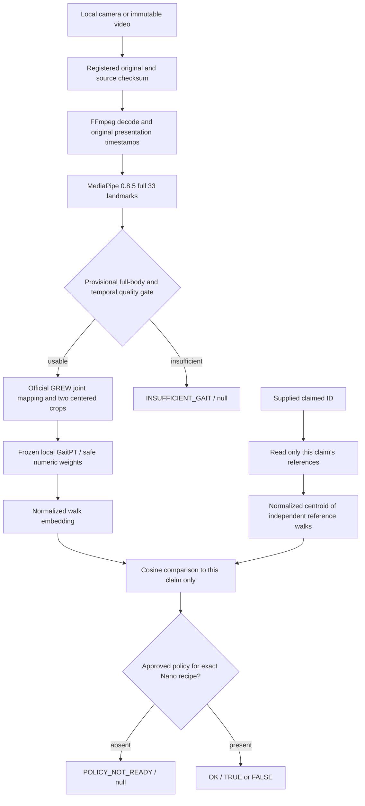

# Nano verification architecture

Status: pre-collection engineering port, 20 October 2026. The owner's explicit
requirements are verification of a supplied claim only and entirely local execution
on the original Jetson Nano. The companion research PRD remains the implementation
contract, with the Nano amendment appended to both copied contract documents.

## Local processing boundary

All boxes execute on the Nano. Preparing numeric weights on a modern workstation
is offline artifact packaging; it is not a video/pose/inference service. There is
no remote client, server endpoint, identity search, gallery ranking or automatic
CPU fallback. File-based capture followed by batch processing is supported; no
real-time throughput has been demonstrated.

## Frozen model and preprocessing

The unmodified official GaitPT source is pinned to
`4977618a36ef77ee9a2863c9f8e27ab862894d70`, with source/config SHA checks before
import. The GREW checkpoint hash is pinned in `src/verification/artifacts.py`.
Workstation export uses restricted `weights_only=True`; Nano loading uses numeric
NPZ with `allow_pickle=False`, archive bounds, finite float32 tensors, and strict
state keys/shapes. Legacy checkpoints are never loaded by this runtime.

MediaPipe33 maps to COCO17 as
`(0,2,5,7,8,11,12,13,14,15,16,23,24,25,26,27,28)`. The source model's 18-point
order is `(0,1,3,0,2,4,5,7,9,6,8,10,11,13,15,12,14,16)`: the repeated nose is
official behavior, not a synthesized neck. XY remains in displayed-image pixels
and both coordinates are divided by image height. No hip centering or historical
78-channel features enter GaitPT.

The longest qualifying contiguous segment produces the official GREW two centered
30-frame crops, including its final-frame exclusion. Crops run sequentially to
bound activation memory. Normalize each crop embedding, average, normalize again.
The real loaded model produced 256 dimensions and 4,484,384 parameters in the
workstation smoke check; the implementation measures dimensions instead of fixing
a model-independent interface to 256. No optimizer or training path exists.

## Media and provisional quality

FFprobe supplies each decoded frame's presentation timestamp, including variable
frame timing. FFmpeg applies display rotation without altering source bytes.
Missing detections retain their frame/time positions. There is no detected-frame
compaction, interpolation or frame-rate resampling. Inputs are bounded to one video
stream, 31–7,200 frames, <=120 seconds, and <=1920x1080 in either orientation.

The current engineering gate requires 31 fully observed consecutive frames spanning
at least 0.8 seconds, visibility >=0.5 for mapped joints and heel/toe points, all
these points inside the frame, adjacent timestamp gaps <=0.1 seconds, leg resolution
>=0.15 image height, and foot motion relative to hips >=0.003 image height.
Large observed pose jumps >0.2 image height are refused. These constants are
**provisional**, not selected biometric thresholds or validated walking/track tests.
MediaPipe's single-person tracker cannot count bystanders or certify stable identity.
The CLI requires explicit operator review via `--single-walker-reviewed`; ambiguous
or multi-person inputs must not be submitted. This port does not reproduce the
research RTMPose multi-person/quality infrastructure or prove liveness.

## References, provenance and response boundary

`data/verification-v2.db` is separate from the old database. Each record retains an
independent original take/hash, subject, role, recipe and normalized walk embedding.
Only `WHERE subject = ?` queries retrieve references; there is no read-all-embeddings
API. A normalized equal-weight centroid is calculated for the supplied claim only.
Zero/nonfinite vectors and incompatible dimensions fail closed. The store (schema v2) allows one
reference per recipe per original but never a second owner; migrated pre-contract rows
are inert. After a model change use a new bundle/database and re-enroll or reprocess the
preserved originals.

`data/recordings.json` reads existing `nano-raw-recordings-v1` records and writes
`nano-recordings-v2`. Managed-study rows still require actual capture metadata,
consent and disjoint development/calibration roles. The two-script USB workflow adds
explicit **operational** enrollment/query rows outside those splits. Enrollment rows
have the supplied owner; query rows require `subject_id: null`. The claim is never
written as the unknown walker's true identity. Operational imports may have unknown
capture date/view/session; registration timestamps are distinct, not invented capture
metadata. Study rows retain their stricter requirements.

Source bytes, reference owner/role and take reuse are checked before and after scoring.
Managed study queries must match reference split role. An explicitly operational
query is outside the study and can compare only the supplied claim's references;
its diagnostics must not be used as labeled calibration/final-study trials. Reference
roles for an enrolled ID remain disjoint. The same ID cannot be silently enrolled
into operational and study roles in one store/registry. Declared derivatives and
locked-final roles remain excluded. Registration is a trusted original-file assertion;
bytes cannot identify undeclared re-encoded copies. This small registry is not the
research capture registry, split lock or locked-test authorization system.

`enroll.py --name` and `identify.py --identity` both default to a fresh USB-camera
walk, consent attestation and supervised single-walker admission. `verify.py` shares
the same verification command. Optional original `--video` input bypasses capture;
unregistered files require explicit `--register-original` and consent. The model and
pose graph are checked before a live walk. The same encoder instance handles the
subsequent inference. Enrollment reports ENROLLED only after the SQLite transaction
commits; a new process reads the same absolute config-resolved database path.

The recipe is the semantic identity of the `nano-deployment-contract-v1`: official
source/config/checkpoint/numeric bundle, MediaPipe version and asset hashes/settings,
raw variant, temporal/native/aggregation/similarity rules and the hashes of the
pixel-to-embedding code. Torch/CUDA/ffmpeg/python/device versions are recorded as
runtime provenance per reference and do not decide compatibility. See
[research integration](RESEARCH_TO_JETSON_MODEL_INTEGRATION.md). Different research RTMPose or Nano
MediaPipe recipes must never share references or a numeric threshold by assumption.

Public results/events contain request ID, supplied claim, status, verdict and message.
Only `OK` has a Boolean; other statuses have null verdicts. There is no public score
or alternative-person output. Opt-in private diagnostics retain query/reference
take/hash, claim, role, recipe and cosine for offline evaluation. Source subject
labels are obtained from the authorized registry by the evaluator, not inferred by
production scoring. No accuracy/threshold is fitted by exporting diagnostics.

## Model slot, lab tooling and the no-final-model state (21 October 2026)

No final research model exists, so enrollment and verification are gated by an explicit
**model slot** (`src/verification/model_slot.py`, `config.yaml: model_slot_dir`). A package is
reported through six separate stages — discovered, structurally valid, runtime compatible,
parity tested (Nano evidence), approved (research-owner record), active — and only an
explicitly activated package that passes the first five on the Nano can run. Otherwise
`enroll`/`verify` return `MODEL_NOT_DEPLOYED` (or `MODEL_INCOMPATIBLE` when the runtime
contract differs from the activated package), with a null verdict and no fallback. The
provisional GaitPT bundle is a `development_only` baseline reachable only through
`--development-baseline`; it is not approvable. Runtime compatibility is a section-by-section
comparison with what this build implements (currently only the official GaitPT-GREW +
MediaPipe 0.8.5 recipe), so other models fail closed until a backend is written.

`scripts/lab.py` adds model-independent hardware tooling (preflight, camera diagnostics, pose
diagnostics, database readiness, model slot, HDMI display) around — not inside — the
recipe-defining modules (`backend`, `media`, `contract`, `deployment` are unchanged and still
define the recipe hash). Capture, SQLite storage and the diagnostics never import a pose
backend; the only coupling is `LocalGaitPT.encode`, whose MediaPipe use is named by the
contract's `pose` section. Diagnostics (`data/diagnostics/`) are never registered as originals.

## Preservation and remaining gates

The old 1:N application and standalone diagnostic scripts are archived byte-for-byte
under `legacy/`; old `models/`, checkpoint, phase reports and user outputs are retained.
The embedded `full_hybrid_best.pth` SHA is
`345f58e6429c8456ea4e937ab5715378b8e5a7285b785c09ef87803c7d6a9904`.
It is a different asset from the audited research shipped E0 and missing controlled
LOSO bundle. Never label its old optimistic metrics as a replay of controlled E0.

Frozen GaitPT is the first Nano implementation, not an empirically selected winner.
GPGait++/GPGait and E0 remain research comparators; their Nano ports are not claimed.
No pilot/cohort, scientific selection, calibrated policy, source-dataset reproduction,
physical Nano validation or license clearance is manufactured by this migration.
The copied research documents include historical links to reports that remain in
the research repository; this repository's executed evidence is recorded separately
in `NANO_MIGRATION_VALIDATION.md`.

See [ADR-001](decisions/001-local-nano-verification.md) for the deployment decision
and [deployment](DEPLOYMENT.md) for the policy/trust boundary.
